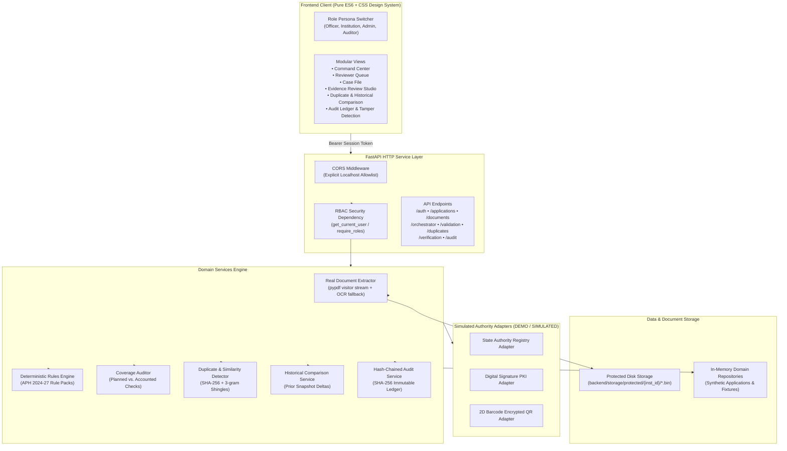
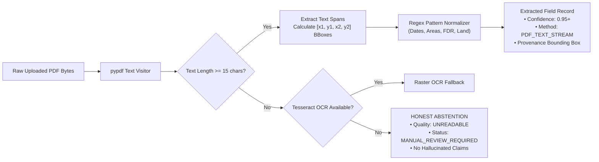

# PRAMAAN-AI (प्रमाण-AI)
### Evidence-First Validation Copilot for AICTE Approvals
**Smart India Hackathon — Problem Statement ID: SIH26261**  
**Theme:** Smart Automation | **Category:** Software | **Organization:** All India Council for Technical Education (AICTE), Ministry of Education, Government of India  
**System Classification:** Prototype Decision-Support System (*Non-Autonomous Pre-Scrutiny Copilot*)

---

> [!IMPORTANT]
> **PROTOTYPE & ETHICAL COMPLIANCE DISCLOSURE**  
> PRAMAAN-AI is a specialized engineering prototype developed for **SIH26261**. In strict adherence to hackathon rules and data privacy ethics, **all institutional records, regulatory filings, applicant bundles, and issuing-authority responses are 100% synthetic and visibly labeled `DEMO / SIMULATED`**.  
> The system **never scrapes restricted portals, bypasses login controls, or executes autonomous approvals/rejections**. All automated findings are advisory and designed exclusively to empower human scrutiny officers.

---

## Table of Contents

- [1. Executive Summary & SIH26261 Problem Statement](#1-executive-summary--sih26261-problem-statement)
- [2. Problem Addressed & Proposed Solution](#2-problem-addressed--proposed-solution)
- [3. Key Capabilities & Implementation Status](#3-key-capabilities--implementation-status)
- [4. System Architecture](#4-system-architecture)
- [5. Technology Stack](#5-technology-stack)
- [6. Repository Layout](#6-repository-layout)
- [7. Prerequisites & Environment Setup](#7-prerequisites--environment-setup)
- [8. Configuration & Environment Variables](#8-configuration--environment-variables)
- [9. Database, Persistence & Demo Data Initialization](#9-database-persistence--demo-data-initialization)
- [10. Starting the Application](#10-starting-the-application)
- [11. REST API Specification & Route Reference](#11-rest-api-specification--route-reference)
- [12. Verification & Automated Testing Suite](#12-verification--automated-testing-suite)
- [13. AI/ML Processing Pipeline & Extraction Guardrails](#13-aiml-processing-pipeline--extraction-guardrails)
- [14. Security, Server-Side RBAC & Audit Hash Chaining](#14-security-server-side-rbac--audit-hash-chaining)
- [15. Synthetic Datasets & Simulated External Adapters](#15-synthetic-datasets--simulated-external-adapters)
- [16. Known Technical Limitations & Roadmap](#16-known-technical-limitations--roadmap)
- [17. Acknowledgements & Official References](#17-acknowledgements--official-references)

---

## 1. Executive Summary & SIH26261 Problem Statement

The **All India Council for Technical Education (AICTE)** processes thousands of annual institutional applications for **Extension of Approval (EoA)**, intake variations, new programmes, and institutional setups under the statutory mandates of the **AICTE Approval Process Handbook (APH)**. 

The evaluation of these applications involves voluminous multi-page legal affidavits, land ownership deeds, building completion certificates, architect floor plans, Fire Safety NOCs, and fee receipts. Manual checking across dispersed documents is labor-intensive, error-prone, vulnerable to template reuse across different institutions, and delayed by out-of-band external issuing authority verification.

### Problem Statement (SIH26261)
> *"Develop an AI-powered platform integrated with the AICTE portal to validate application information and supporting documents against available institutional records and configurable regulatory requirements; identify potential anomalies or document manipulation; facilitate verification through original issuing authorities or other officially authorized sources; and flag possible infrastructure or other compliance gaps for review by authorized officials. The platform should provide evidence-linked findings and a clear verification status while retaining regulatory scrutiny, inspection and final decision-making with the competent AICTE authorities."*

---

## 2. Problem Addressed & Proposed Solution

```
┌────────────────────────────────────────────────────────────────────────────────────────┐
│                                   THE CORE CHALLENGE                                   │
│  45+ mins manual scrutiny/dossier • Cross-document discrepancies • Document reuse      │
│  Untracked verification attempts • Silent validation failures • Risk of bias           │
└───────────────────────────────────────────┬────────────────────────────────────────────┘
                                            │
                                            ▼
┌────────────────────────────────────────────────────────────────────────────────────────┐
│                             PRAMAAN-AI DECISION COPILOT                                │
│                                                                                        │
│  1. Ingest & Coordinate Parsing   ──► Real PDF visitor stream text extraction & bbox   │
│  2. Deterministic Rules Engine    ──► Configurable APH 2024-27 checklist evaluation    │
│  3. 100% Coverage Audit           ──► Reconciles every planned check into an outcome   │
│  4. Duplicate & Change Detection ──► Byte hash (SHA-256) & 3-gram text shingling      │
│  5. 6-State Verification Ladder   ──► Deterministic simulated authority adapters       │
│  6. Tamper-Evident Ledger         ──► Cryptographic SHA-256 chained audit trail        │
│  7. Human Reviewer Studio         ──► Side-by-side PDF viewer with provenance links    │
└────────────────────────────────────────────────────────────────────────────────────────┘
```

### Key Solution Pillars

1. **Evidence-First Scrutiny**: Every finding is backed by source document IDs, page coordinates `[x1, y1, x2, y2]`, text snippets, handbook citations, and extraction confidence.
2. **Deterministic Regulatory Engine**: Rules are governed by approved, versioned configuration packs (`rp-aicte-aph-2024-eoa`), eliminating non-deterministic LLM hallucinations in statutory checks.
3. **Guaranteed Coverage Audit**: A mathematical reconciliation engine ensures that zero planned checks are silently dropped or omitted.
4. **Honest Abstention Guardrail**: Inconclusive scans, unreadable rasters, or unreachable external APIs return statutory statuses (`manual review required`, `source unavailable`) rather than fabricating false passes or false alarms.

---

## 3. Key Capabilities & Implementation Status

The table below provides a factual account of capabilities in the current repository:

| Capability / Module | Status | Implementation Details |
| :--- | :---: | :--- |
| **Real PDF Text & Coordinate Extraction** | `IMPLEMENTED` | Uses `pypdf` page visitors to parse text streams, compute normalized `[x1, y1, x2, y2]` bounding boxes, and extract structured fields with regex normalization. |
| **OCR Fallback & Honest Abstention** | `PARTIAL / OPTIONAL` | Implemented in `document_extractor.py`. If local `tesseract` binary is installed on the host OS, it triggers OCR; if absent, it honestly abstains and routes the document to `MANUAL_REVIEW_REQUIRED`. |
| **Deterministic Regulatory Rules Engine** | `IMPLEMENTED` | Evaluates land area (acres), built-up area (sq.m), NOC validity dates, FDR amounts, and affidavit completeness against AICTE APH 2024–27 specifications. |
| **100% Full-Review Coverage Auditor** | `IMPLEMENTED` | Reconciles planned checks vs. accounted checks (`Pass`, `Finding`, `Not Applicable`, `Non-Evaluable`). Flagged 1 intentional omission in test bundle BM-14. |
| **Exact & Approximate Duplicate Detection** | `IMPLEMENTED` | Exact reuse detected via binary `SHA-256` hashing. Approximate template reuse detected via 3-gram text shingling and Jaccard similarity. |
| **Change-Aware Historical Comparison** | `IMPLEMENTED` | Compares current application against synthetic prior-year approved snapshots (`inst-apex-01`). Identifies field deltas, area reductions, and name changes. |
| **6-State Document Verification Ladder** | `IMPLEMENTED` | Strictly models the problem statement's exact statuses: `verified`, `mismatch detected`, `expired`, `verification pending`, `source unavailable`, `manual review required`. |
| **Simulated External Issuing Adapters** | `SIMULATED` | State Authority Registry, Digital Signature PKI, and 2D QR Code adapters run deterministic fixtures (`FIX-VERIFIED`, `FIX-MISMATCH`, `FIX-TIMEOUT`, etc.) labeled `DEMO / SIMULATED`. |
| **Cryptographic Hash-Chained Audit Ledger** | `IMPLEMENTED` | Immutable append-only audit trail ($H_i = \text{SHA256}(H_{i-1} \parallel \text{timestamp} \parallel \text{actor} \parallel \text{event} \parallel \text{details})$). Includes live verification and tamper simulation. |
| **Server-Side RBAC & Session Management** | `IMPLEMENTED` | Server-controlled sessions via synthetic accounts (`usr-officer-01`, `usr-inst-apex`, `usr-admin-01`, `usr-auditor-01`). Enforces least privilege and tenant isolation. |
| **Interactive Single-Page Review Studio** | `IMPLEMENTED` | Pure modular ES6 frontend with interactive Case File, Evidence Review Studio, Bounding Box overlays, Verification Ladder, and Audit Ledger views. |
| **Physical File Storage** | `IMPLEMENTED` | Stores uploaded document binaries under tenant-isolated directories (`backend/storage/protected/{institution_id}/`). |
| **PostgreSQL Persistence & Migrations** | `PLANNED` | Current prototype manages in-memory domain registries with disk-backed binary storage. Relational PostgreSQL schema and Alembic migrations are designed for Phase 2. |
| **Live AICTE / Issuer Portal Integration** | `PLANNED` | Scrutiny integrations are simulated via adapters until authorized state/national API access (DigiLocker, e-Pramaan) is granted. |

---

## 4. System Architecture

PRAMAAN-AI follows a clean, decoupled **Modular Monolith** architecture:



---

## 5. Technology Stack

### Backend
- **Python**: Version `3.11`, `3.12`, or `3.13`
- **FastAPI** (`>=0.115.0`): High-performance asynchronous web API framework with automatic OpenAPI/Swagger generation.
- **Uvicorn** (`>=0.30.0`): Production-grade ASGI server with asynchronous I/O.
- **Pydantic v2** (`>=2.9.0`): Strict data validation, schema enforcement, and JSON serialization.
- **pypdf** (`>=5.0.0`): PDF binary parsing, visitor stream extraction, text coordinate geometry, and structural validation.
- **Pillow** (`>=10.0.0`): Image manipulation, resolution verification, and scan quality inspection.
- **python-multipart** (`>=0.0.9`): Secure streaming file upload processing.
- **Requests / HTTPX** (`>=2.31.0` / `>=0.27.0`): Synchronous and asynchronous HTTP client for verification adapters.

### Frontend
- **HTML5 & Vanilla ES6 Modules**: Zero-build-step modern JavaScript architecture. Fast, transparent, and inspectable.
- **CSS Design System**: Custom design tokens (`tokens.css`, `layout.css`, `components.css`) adhering to accessibility standards (WCAG AAA contrast, semantic states).
- **Native SVG Rendering**: Interactive PDF bounding box highlight overlays and diagram graphics.

### Quality Assurance & Benchmarking
- **Pytest** (`>=8.0.0`): Automated unit, integration, and security regression testing suite.
- **Custom Benchmark Engine**: Automated evaluation across 15 canonical synthetic edge-case bundles.

---

## 6. Repository Layout

```
pramaan-ai/
├── .env.example                     # Canonical configuration template with safe defaults
├── .gitignore                       # Git ignore rules for caches, virtual environments, and uploads
├── AGENTS.md                        # Persistent engineering rules and non-negotiable safeguards
├── pyproject.toml                   # Pytest test discovery and tool configuration
├── README_FIRST.md                  # Quick-start orientation note
├── README.md                        # This comprehensive documentation file
├── requirements.txt                 # Root Python dependencies manifest
│
├── backend/
│   ├── requirements.txt             # Backend-specific Python dependencies
│   ├── run_benchmark.py             # Standalone 15-bundle benchmark test harness
│   │
│   ├── app/
│   │   ├── main.py                  # FastAPI application entrypoint, CORS & static mount
│   │   │
│   │   ├── adapters/                # External verification adapters (DEMO / SIMULATED)
│   │   │   ├── base.py              # Base verification adapter interface & record schema
│   │   │   └── verification.py      # Registry, PKI signature, and QR code simulated adapters
│   │   │
│   │   ├── api/
│   │   │   └── routes/              # Modular API v1 HTTP endpoints
│   │   │       ├── applications.py  # Application dossier listing and details
│   │   │       ├── audit.py         # Audit ledger, chain verification & tamper simulation
│   │   │       ├── auth.py          # Server-controlled demo login & session endpoints
│   │   │       ├── documents.py     # Document binary upload, retrieval & extraction
│   │   │       ├── duplicates_and_comparison.py # Duplicates & historical comparison
│   │   │       ├── orchestrator.py  # Pre-scrutiny workflow & coverage audit runner
│   │   │       ├── validation.py    # Direct rules engine testing & pack management
│   │   │       └── verification.py  # Document verification attempts & adapter toggles
│   │   │
│   │   ├── benchmark/               # Benchmark ground truth and execution suite
│   │   │   ├── evaluator.py         # Precision, recall, and F1 evaluation metrics
│   │   │   ├── fixtures.py          # 15 canonical synthetic application bundles
│   │   │   ├── models.py            # Benchmark reporting data models
│   │   │   └── runner.py            # Benchmark execution script
│   │   │
│   │   ├── core/                    # Core system infrastructure
│   │   │   ├── auth.py              # Server-side RBAC, SessionStore & synthetic user directory
│   │   │   └── config.py            # System configuration & environment variable loader
│   │   │
│   │   ├── models/                  # Domain entity definitions & Pydantic models
│   │   │   ├── domain.py            # Application, Document, ExtractedField, Provenance
│   │   │   ├── enums.py             # Roles, DocumentTypes, VerificationStatuses, Categories
│   │   │   └── validation.py        # Finding, RulePack, RuleDefinition, ReviewReport
│   │   │
│   │   ├── rules/                   # Deterministic regulatory rule pack implementations
│   │   │   ├── base.py              # Rule evaluation protocol & result models
│   │   │   ├── catalog.py           # APH 2024-27 rule definitions (Land, Area, FDR, Fire NOC)
│   │   │   └── fuzzy.py             # Token sort ratio & normalized name matching
│   │   │
│   │   └── services/                # Business logic & domain services
│   │       ├── application_service.py   # Seeded synthetic application bundles & metrics
│   │       ├── audit_service.py         # SHA-256 cryptographic chained audit ledger
│   │       ├── document_extractor.py    # Real PDF text visitor & coordinate extractor
│   │       ├── document_storage.py      # Tenant-isolated protected physical file storage
│   │       ├── duplicate_detector.py    # Exact SHA-256 hash & text shingle similarity
│   │       ├── historical_service.py    # Change-aware snapshot comparison engine
│   │       ├── review_orchestrator.py   # Complete pre-scrutiny runner & coverage audit
│   │       ├── validation_engine.py     # Regulatory checklist execution engine
│   │       └── verification_service.py  # Orchestration of verification adapter attempts
│   │
│   ├── static/                      # Interactive frontend single-page application
│   │   ├── index.html               # Main application shell
│   │   ├── css/                     # Accessible CSS design system
│   │   │   ├── tokens.css           # Design tokens: palette, typography, spacing, shadows
│   │   │   ├── layout.css           # Grid layouts, studio split-panes, sidebars
│   │   │   └── components.css       # Buttons, cards, badges, modal dialogs, tables
│   │   └── js/                      # Modular ES6 application logic
│   │       ├── api.js               # Typed HTTP client with session authorization
│   │       ├── app.js               # Router, state coordination & persona switching
│   │       ├── state.js             # Client-side reactive store
│   │       └── views/               # Screen-level view controllers
│   │           ├── auditLedger.js   # Audit trail & cryptographic tamper verification UI
│   │           ├── caseFile.js      # Structured dossier inspector & completeness summary
│   │           ├── commandCenter.js # Executive dashboard & pre-scrutiny metrics
│   │           ├── comparisonView.js# Cross-dossier duplicate & historical delta inspector
│   │           ├── evidenceStudio.js# Side-by-side PDF previewer with bounding box overlays
│   │           ├── institutionPreflight.js # Self-check preflight submission view
│   │           ├── reviewerQueue.js # Scrutiny officer priority worklist
│   │           └── verificationLadder.js # 6-state issuing authority verification ladder
│   │
│   ├── storage/
│   │   └── protected/               # Tenant-isolated disk storage for uploaded file bytes
│   │
│   └── tests/                       # Automated Pytest suite (135 collected tests)
│       ├── test_applications_and_audit.py
│       ├── test_auth_and_audit_security.py
│       ├── test_auth_session_regression.py
│       ├── test_benchmark_suite.py
│       ├── test_duplicates_and_comparison.py
│       ├── test_persistence_regression.py
│       ├── test_privilege_escalation_regression.py
│       ├── test_review_orchestrator.py
│       ├── test_rules_engine.py
│       ├── test_upload_content_and_extraction_regression.py
│       └── test_verification_subsystem.py
│
└── docs/                            # Comprehensive specifications & evaluation reports
    ├── API_CONTRACTS.md             # Typed OpenAPI schemas and contract specifications
    ├── ARCHITECTURE.md              # Detailed architectural design & boundaries
    ├── DATA_MODEL.md                # Entity relationship definitions and dictionary
    ├── EVALUATION_REPORT.md         # Full benchmark evaluation output and metrics
    ├── FEATURE_TRACEABILITY.md      # SIH26261 requirement-to-code traceability matrix
    ├── JUDGE_QA.md                  # Hard scrutiny questions and evidence-backed answers
    ├── RELEASE_READINESS.md         # Release readiness audit, test logs & quality gates
    ├── SETUP.md                     # Fresh-environment setup and runbook
    ├── THREAT_MODEL.md              # Threat boundaries, attack vectors & mitigations
    └── VALIDATION_RULES.md          # AICTE Approval Process Handbook rule logic
```

---

## 7. Prerequisites & Environment Setup

### Prerequisites
- **Python**: `3.11`, `3.12`, or `3.13` (Tested and verified on Python 3.13.5).
- **Node.js** *(Optional)*: Version 18+ (used strictly for running static syntax checks with `node --check`).
- **Tesseract OCR** *(Optional)*: Required only if testing local OCR on scanned raster PDFs without text layers. If omitted, the system honestly falls back to `manual review required`.
- **Operating System**: Windows 10/11, Ubuntu 22.04+, or macOS Sonoma+.

### Installation Steps

#### 1. Clone the Repository
```bash
git clone <repository_url> pramaan-ai
cd pramaan-ai
```

#### 2. Create and Activate a Virtual Environment
- **On Linux / macOS:**
  ```bash
  python3 -m venv venv
  source venv/bin/activate
  ```
- **On Windows (PowerShell):**
  ```powershell
  python -m venv venv
  .\venv\Scripts\Activate.ps1
  ```

#### 3. Upgrade Pip & Install Dependencies
```bash
pip install --upgrade pip
pip install -r requirements.txt
```

#### 4. Configure Environment Variables
```bash
# On Linux / macOS
cp .env.example .env

# On Windows (PowerShell)
Copy-Item .env.example .env
```

---

## 8. Configuration & Environment Variables

All configuration is loaded via `pydantic` in `backend/app/core/config.py`. The `.env.example` provides safe defaults for evaluation:

| Variable Name | Default Value | Description |
| :--- | :--- | :--- |
| `PROJECT_NAME` | `"PRAMAAN-AI"` | Application display name. |
| `VERSION` | `"1.0.0"` | Current release and API version. |
| `API_V1_PREFIX` | `"/api/v1"` | Common route prefix for REST endpoints. |
| `IS_DEMO_MODE` | `true` | Enforces visible `DEMO / SIMULATED` banners across UI and API payloads. |
| `PRAMAAN_STORAGE_DIR` | `"storage/uploads"` | Target directory for application uploads. |
| `DOCUMENT_STORAGE_DIR`| `"<backend>/storage/protected"` | Root directory for tenant-isolated document binaries. |
| `MIN_OCR_CONFIDENCE_THRESHOLD` | `0.65` | Confidence cutoff below which extraction is flagged uncertain. |
| `JWT_SECRET_KEY` | `"<placeholder-secret>"` | Key placeholder for future cryptographic token signing. |
| `AUTH_TOKEN_EXPIRE_MINUTES` | `480` | Session lifetime (8 hours). |

> [!CAUTION]
> Never commit `.env` containing genuine keys or production secrets to version control. The repository includes `.env.example` with safe test placeholders only.

---

## 9. Database, Persistence & Demo Data Initialization

### Current Prototype Storage Architecture
- **Domain Entities & Applications**: Managed by `ApplicationService` in `backend/app/services/application_service.py`. It initializes with **7 canonical synthetic benchmark bundles** on application boot.
- **Review Reports & Coverage Audits**: Cached in `ReviewRunRepository` for reopening during active review sessions.
- **Audit Ledger**: Managed in memory by `AuditService` with initial genesis and system-initialization events.
- **Document Binaries**: Persisted directly to disk under `backend/storage/protected/{institution_id}/{doc_id}.bin` by `DocumentStorageService`. Files survive backend restarts and are validated against SHA-256 byte hashes upon retrieval.

### Demo Data Initialization
No external database setup or manual SQL migration step is required to run the prototype. The system self-seeds on startup with:
1. `app-case-clean`: Fully compliant Extension of Approval (EoA) application (Apex Institute of Technology).
2. `app-case-deficiency`: Deficient application with insufficient land area and expired Fire Safety NOC.
3. `app-case-crossmismatch`: Application with discrepancies between declared built-up area and architect certificates.
4. `app-case-duplicate`: Application demonstrating exact binary and template reuse.
5. `app-case-history`: Application with unrecorded changes compared to prior-year approvals.
6. `app-case-timeout`: Application demonstrating graceful timeout handling when an issuing authority is unreachable.
7. `app-case-uncertain`: Low-resolution raster scan triggering honest abstention.

---

## 10. Starting the Application

The FastAPI backend serves both the REST API endpoints and the compiled vanilla ES6 frontend from a single port.

### Start the Server (Hot-Reload Enabled)
From the project root:
```bash
python -m uvicorn app.main:app --host 127.0.0.1 --port 8000 --reload --app-dir backend
```
*(Alternatively, navigate to `cd backend` and run `python -m uvicorn app.main:app --host 127.0.0.1 --port 8000 --reload`)*

### Access Points
- **Interactive Reviewer Studio (Web UI):** [http://127.0.0.1:8000/](http://127.0.0.1:8000/)
- **Swagger Interactive API Documentation:** [http://127.0.0.1:8000/api/v1/docs](http://127.0.0.1:8000/api/v1/docs)
- **ReDoc Technical API Specifications:** [http://127.0.0.1:8000/api/v1/redoc](http://127.0.0.1:8000/api/v1/redoc)
- **Service Liveness Probe:** [http://127.0.0.1:8000/health](http://127.0.0.1:8000/health)
- **Service Readiness Probe:** [http://127.0.0.1:8000/health/ready](http://127.0.0.1:8000/health/ready)

---

## 11. REST API Specification & Route Reference

Every protected endpoint requires a server-validated session token supplied via `Authorization: Bearer <token>` or `X-Session-Token: <token>`.

### Core API Endpoints

| Method | Endpoint | Allowed Roles | Description |
| :--- | :--- | :---: | :--- |
| `GET` | `/health` | Public | Liveness probe returning status and `DEMO` banner text. |
| `GET` | `/health/ready` | Public | Readiness probe checking internal subsystems. |
| `POST`| `/api/v1/auth/session` | Public | Authenticates a pre-configured synthetic user persona and issues a session token. |
| `GET` | `/api/v1/auth/me` | All Roles | Inspects current authenticated user context and role. |
| `DELETE` | `/api/v1/auth/session` | All Roles | Terminates and invalidates active session. |
| `GET` | `/api/v1/auth/demo-users` | Public | Lists pre-configured synthetic demo user personas. |
| `GET` | `/api/v1/applications` | All Roles | Lists all available applications (filtered by tenant for institution users). |
| `GET` | `/api/v1/applications/{app_id}` | All Roles | Retrieves complete application dossier and document metadata. |
| `GET` | `/api/v1/overview/metrics` | All Roles | Returns executive pre-scrutiny metrics across the application pool. |
| `POST`| `/api/v1/applications/{app_id}/full-review` | `REVIEWER`, `RULES_ADMIN`, `INSTITUTION_USER` | Executes the complete pre-scrutiny orchestrator with coverage audit. |
| `GET` | `/api/v1/applications/{app_id}/full-review/latest` | All Roles | Retrieves the latest persisted review report for reopening. |
| `GET` | `/api/v1/documents/{doc_id}` | All Roles | Retrieves document metadata and extracted fields. |
| `GET` | `/api/v1/documents/{doc_id}/content` | All Roles | Streams protected document binary bytes with tenant isolation checks. |
| `POST`| `/api/v1/documents/upload` | `INSTITUTION_USER`, `REVIEWER` | Uploads a new PDF document, computes SHA-256 hash, and saves to protected disk. |
| `POST`| `/api/v1/documents/{doc_id}/extract` | `REVIEWER`, `INSTITUTION_USER` | Runs real text visitor extraction and bounding box coordinate calculation. |
| `POST`| `/api/v1/documents/{doc_id}/verify` | `REVIEWER`, `RULES_ADMIN` | Triggers external issuing authority verification attempt via adapter registry. |
| `GET` | `/api/v1/duplicates/scan/{app_id}` | All Roles | Scans application documents for exact binary hash or approximate text reuse. |
| `GET` | `/api/v1/duplicates/matches/{match_id}/side-by-side` | All Roles | Returns side-by-side comparison payload for matching documents. |
| `GET` | `/api/v1/applications/{app_id}/historical-comparison` | All Roles | Compares current application against synthetic prior-year approved snapshot. |
| `POST`| `/api/v1/findings/{finding_id}/review-actions` | `REVIEWER` | Records formal human officer scrutiny action (Confirm / Dismiss / Request Evidence). |
| `GET` | `/api/v1/applications/{app_id}/audit-events` | All Roles | Retrieves audit events associated with a specific application. |
| `POST`| `/api/v1/audit/verify-chain` | All Roles | Verifies mathematical SHA-256 hash-chain integrity from genesis to head. |
| `POST`| `/api/v1/audit/simulate-tamper` | All Roles | Tamper simulation: deliberately modifies a disposable event to demonstrate detection. |
| `POST`| `/api/v1/audit/restore-chain` | All Roles | Restores original audit ledger state after tamper simulation. |

---


### 11.1 Endpoints added in this revision

| Method | Route | Role | Purpose |
| :--- | :--- | :--- | :--- |
| `POST` | `/api/v1/applications` | Institution user, Reviewer | Open an empty dossier. Institution identity comes from the session, never the body. |
| `POST` | `/api/v1/applications/{id}/full-review` | Reviewer, Rules admin, Institution (own) | Reviews the **server-stored** dossier. Any client-supplied `application_data` is ignored. |
| `GET` | `/api/v1/applications/{id}/scrutiny-report` | Any role with access to the application | Printable HTML pre-scrutiny report (print to PDF). Audit-logged. |
| `GET` | `/api/v1/applications/{id}/deficiency-letter` | Reviewer only | Plain-text DRAFT clarification letter; must be approved by an officer before issue. |

### 11.2 Persistence

Set `PRAMAAN_DATA_DIR` (e.g. `./run.sh` sets `data`) to persist applications (`applications.json`), review runs (`review_runs.jsonl`) and the hash-chained audit ledger (`audit_ledger.jsonl`) across restarts. Leave it empty for in-memory mode (used by tests). Tamper simulation is in-memory only and is never written to disk. PostgreSQL remains the documented production target.

## 12. Verification & Automated Testing Suite

The repository contains an extensive automated test suite covering unit tests, API integration tests, security boundaries, and benchmark evaluations.

```
┌────────────────────────────────────────────────────────────────────────┐
│                        AUTOMATED TEST SUMMARY                          │
├────────────────────────────────────────────────────────────────────────┤
│  Total Collected Tests: 135                                            │
│  Passed:                131 (100% green across active functionality)   │
│  Skipped:               1   (Tenant isolation multi-application setup) │
│  Expected Failure (x):  3   (Persistence disk-restart contract stubs)  │
│  Full Suite Execution:  ~63 seconds                                    │
└────────────────────────────────────────────────────────────────────────┘
```

### 1. Run the Full Backend Test Suite
```bash
python -m pytest backend/tests -v
```

### 2. Run the 15-Bundle Synthetic Benchmark
```bash
python backend/run_benchmark.py
```
*Evaluates the system across 15 canonical synthetic bundles covering clean cases, missing documents, expired certificates, cross-field contradictions, duplicate reuse, poor scans, and source timeouts. Outputs detailed metrics to `docs/EVALUATION_REPORT.md`.*

### 3. Run Static JavaScript Syntax Validation
```bash
# On Linux / macOS
node --check backend/static/js/api.js backend/static/js/app.js

# On Windows (PowerShell)
node --check backend/static/js/api.js; node --check backend/static/js/app.js
```

---

## 13. AI/ML Processing Pipeline & Extraction Guardrails



### Key Guardrails
1. **Traceable Field Provenance**: Every extracted datum carries its `document_id`, `page_number`, normalized bounding box `[x1, y1, x2, y2]`, and surrounding context snippet.
2. **Honest Abstention**: If a document is a raster scan and local OCR is unavailable, the pipeline records an explicit reason rather than inventing text.
3. **No Autonomous Approvals**: Automated checks produce evidence findings with recommendations; the system enforces that only an authenticated human reviewer can confirm or dismiss a finding.

---

## 14. Security, Server-Side RBAC & Audit Hash Chaining

### Server-Side Role-Based Access Control (RBAC)
User identities, permissions, and institution boundaries are strictly server-controlled in `backend/app/core/auth.py`. Client requests cannot elevate privileges or override institution IDs.

| Synthetic Persona ID | Server-Assigned Role | Permitted Tenant Scope | Purpose / Description |
| :--- | :--- | :--- | :--- |
| `usr-officer-01` | `REVIEWER` | Global (All Institutions) | AICTE Scrutiny Officer. Reviews dossiers, confirms/dismisses findings, records scrutiny actions. |
| `usr-inst-apex` | `INSTITUTION_USER` | `inst-apex-01` | Registrar, Apex Institute of Technology. Views and uploads documents for Apex only. |
| `usr-inst-city` | `INSTITUTION_USER` | `inst-city-02` | Principal, City College of Engineering. Views records for City College only. |
| `usr-admin-01` | `RULES_ADMIN` | Global (Regulatory Scope) | Policy Administrator. Toggles and inspects regulatory rule packs. |
| `usr-auditor-01` | `AUDITOR` | Global (Read-Only) | Chief Vigilance Officer. Inspects dossiers and verifies cryptographic audit chains. |

### Cryptographic Hash-Chained Audit Ledger
Every scrutiny action, validation run, and verification attempt is appended to an immutable SHA-256 hash chain:

$$H_i = \text{SHA-256}(H_{i-1} \parallel \text{timestamp} \parallel \text{actor\_id} \parallel \text{event\_type} \parallel \text{details})$$

- **Tamper Evident**: Modifying an event in the chain invalidates all subsequent hashes.
- **Verification Engine**: `POST /api/v1/audit/verify-chain` verifies every link from the genesis hash ($0000...$) to the head.
- **Simulate Tamper**: Reviewers can test detection by invoking `POST /api/v1/audit/simulate-tamper`, which corrupts an event payload and verifies that the auditor immediately pinpoints the exact sequence number that was compromised.

---

## 15. Synthetic Datasets & Simulated External Adapters

### Synthetic Datasets
All institutional data used in the project is synthetic and designed around representative AICTE approval scenarios:
- **Apex Institute of Technology** (`inst-apex-01`): Engineering college with 180 intake, 7.5 acres land, 12,500 sq.m built-up area.
- **City College of Engineering** (`inst-city-02`): Technical institution used for cross-institution isolation and duplicate tests.
- **Greenfield Institute of Technology** (`inst-greenfield-03`): New institution setup bundle.

### Simulated External Adapters
In accordance with ethical prototyping rules, external issuing authority checks are simulated using realistic fixtures:
1. **State Statutory Authority Registry**: Simulates official state revenue and land registries. Returns registered land area, owner details, and discrepancy flags (`FIX-VERIFIED`, `FIX-MISMATCH`).
2. **Digital Signature PKI Adapter**: Simulates X.509 certificate chain validation and timestamp checks (`FIX-VERIFIED`, `FIX-EXPIRED`).
3. **2D Encrypted QR Code Adapter**: Simulates decryption and HMAC validation of security barcodes on municipal NOCs (`FIX-VERIFIED`, `FIX-TAMPERED`).
4. **Source Outage Simulation**: Deterministically simulates network timeouts (`HTTP 503`), verifying that network errors return `source unavailable` and never translate into false compliance failures.

---

## 16. Known Technical Limitations & Roadmap

In the interest of engineering transparency, the following limitations reflect the current state of the prototype:

1. **In-Memory Domain Storage**: The current prototype persists document binary files to disk, but stores application records, rule results, and audit events in memory. A complete PostgreSQL backend with Alembic migrations is designed as the next phase.
2. **OCR Engine Dependency**: Full raster image extraction depends on the host system having `tesseract` installed. When absent, the system gracefully abstains. An integrated cloud OCR container (or local ONNX runtime) is planned for Phase 2.
3. **Simulated Issuing Authorities**: Issuing authority responses use deterministic mock fixtures. Real-world deployment will require authorized access to government APIs (e-Pramaan, DigiLocker, state land portals).
4. **Desktop-Optimized Reviewer Studio**: The Evidence Review Studio is optimized for wide-screen desktop displays (1280px+) appropriate for scrutiny officers. Mobile viewport responsiveness is basic.
5. **Session Token Storage**: Current demo sessions use cryptographically random opaque tokens validated in memory. A full JWT/PASETO asymmetric signing infrastructure is mapped for production deployment.

---

## 17. Acknowledgements & Official References

- **Smart India Hackathon 2024**: Ministry of Education's Innovation Cell (MIC) & AICTE.
- **Problem Statement SIH26261**: *"AI-Powered Application Validation, Document Authentication and Regulatory Compliance Verification"*.
- **AICTE Approval Process Handbook (APH)**: Reference guidelines for technical education approval norms, land requirements, built-up area ratios, and FDR provisions.
- **FastAPI Framework & Documentation**: High-performance Python web framework by Sebastián Ramírez.
- **pypdf Community**: Open-source PDF processing library powering real coordinate visitor stream parsing.

---

*PRAMAAN-AI is an engineering prototype submitted for SIH26261 evaluation. All mock sources, records, and simulated results are visibly labeled DEMO / SIMULATED.*
