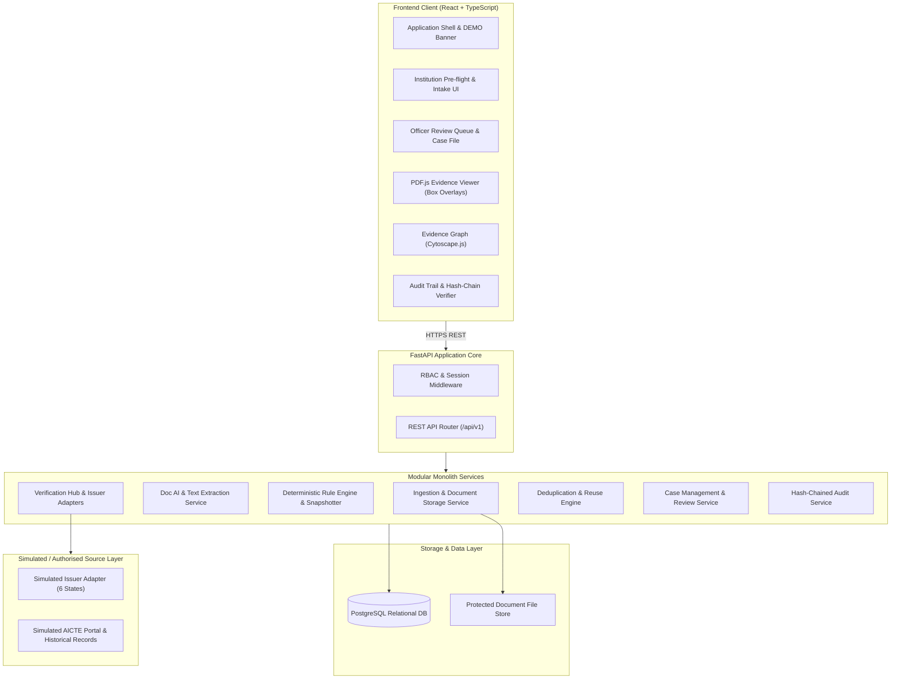
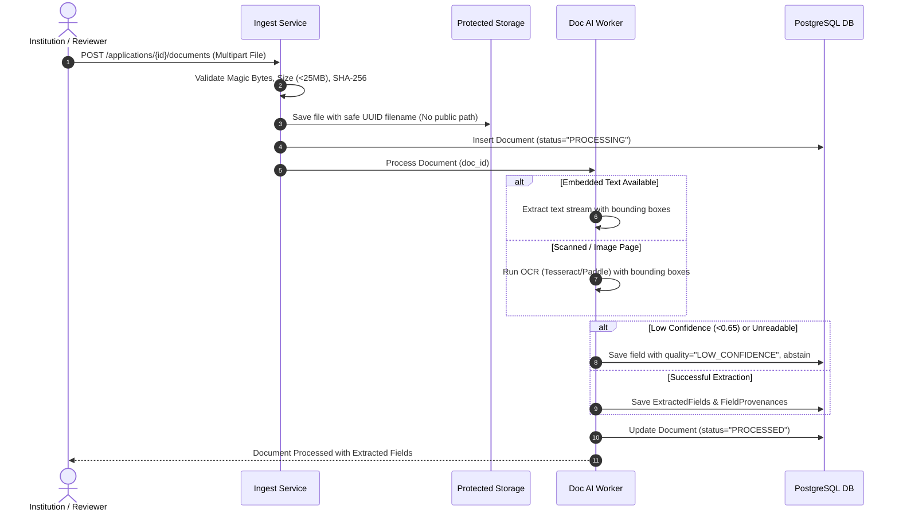
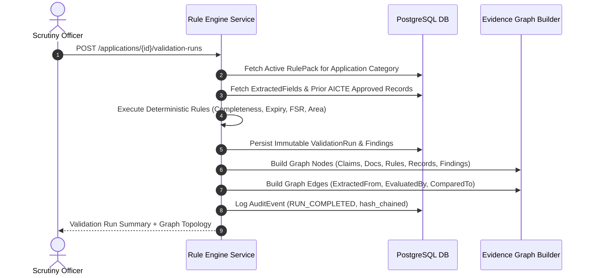
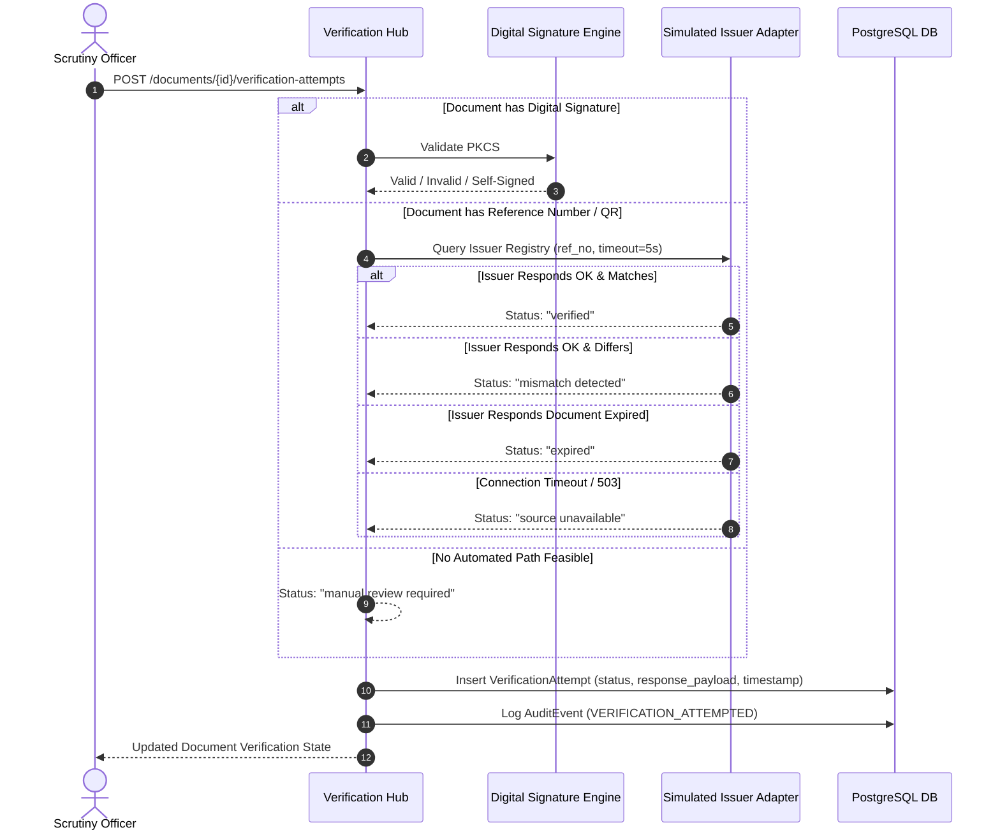

# PRAMAAN-AI: System Architecture & Technical Design

**Document Status:** Approved Architecture Baseline (Planning Only)  
**Version:** 1.0.0  
**Stack:** React + TypeScript (Vite, Tailwind, PDF.js, Cytoscape.js) | Python FastAPI (SQLAlchemy, Alembic, Pydantic) | PostgreSQL | Protected Local Storage  

---

## 1. Architectural Philosophy & Style

PRAMAAN-AI is architected as a **modular monolith**. It avoids premature microservices, message brokers, or distributed queues for the SIH prototype while maintaining strict domain boundaries that allow future horizontal extraction into independent services if warranted by scale.

---

## 2. Module Boundaries & Responsibilities

| Module | Core Responsibility | Internal Dependencies | Output Artifacts |
|---|---|---|---|
| **`ingestion`** | Validates uploaded files (magic MIME check, size/page limits, SHA-256 calculation). Prevents path traversal and writes to protected store. | Storage backend | `Document` record with hash and server-side storage key. |
| **`document_ai`** | Extracts text and layout. Uses embedded PDF text first, falls back to OCR (Tesseract) on scanned pages. Computes bounding boxes and extraction confidence. | `ingestion` | `ExtractedField` with `FieldProvenance` (page index, coordinates, text). |
| **`rule_engine`** | Loads versioned APH rule packs. Executes deterministic validation against application fields and AICTE historical baselines. Generates immutable findings. | `document_ai`, `persistence` | `ValidationRun`, `Finding`, and `FindingEvidence` records. |
| **`verification`** | Implements the Verification Ladder. Coordinates digital signature verification, QR decoding, and external registry lookups via provider-agnostic adapters. | `ingestion`, `external_adapters` | `VerificationAttempt` with one of 6 honest statuses. |
| **`reuse_engine`** | Detects cross-application file reuse using exact SHA-256 and text fingerprinting. Flags potential overlap for review. | `ingestion`, `persistence` | `DocumentDuplicate` records with similarity metrics. |
| **`review`** | Manages officer case files, reviewer decisions (`confirm`, `dismiss`, `rectify`, `inspect`), and updates application workflow status. | `rule_engine`, `verification` | `ReviewAction` audit records and updated case states. |
| **`audit`** | Appends structured security and compliance events to a tamper-evident SHA-256 cryptographic hash chain. Provides audit verification engine. | All modules | Hash-chained `AuditEvent` ledger. |

---

## 3. End-to-End System Workflows & Data Flows

### 3.1 Document Ingestion & Field Extraction Pipeline

### 3.2 Deterministic Validation Run & Evidence Graph Construction

### 3.3 Verification Ladder Execution

---

## 4. Evidence Graph Architecture

The Evidence Graph forms the primary cognitive bridge between raw documentation and regulatory compliance. It is modeled as a Directed Acyclic Graph (DAG) queryable via `GET /applications/{id}/evidence-graph`.

### Graph Entity Classes (Nodes)
1. `DocumentNode`: Represents an uploaded PDF/image (e.g., `DOC-NOC-FIRE-2026`).
2. `ClaimNode`: An extracted field asserting a factual statement (e.g., `Built-Up Area: 12,400 sq.m`).
3. `RuleNode`: A versioned regulatory clause from the APH (e.g., `RULE-APH-003 v1.0`).
4. `ReferenceNode`: Baseline record from authorized AICTE historical database (e.g., `Prior Approved Intake: 180`).
5. `FindingNode`: Result of rule evaluation (e.g., `DEFICIENCY: Area deficit of 800 sq.m`).
6. `VerificationNode`: External issuer confirmation record (e.g., `VERIFIED: State Fire Service`).

### Graph Relational Predicates (Edges)
- `EXTRACTED_FROM`: `ClaimNode` $\to$ `DocumentNode` (carries page number and bounding box coordinates).
- `EVALUATED_AGAINST`: `ClaimNode` $\to$ `RuleNode`.
- `COMPARED_WITH`: `ClaimNode` $\to$ `ReferenceNode`.
- `PRODUCED_FINDING`: `RuleNode` $\to$ `FindingNode`.
- `AUTHENTICATED_BY`: `DocumentNode` $\to$ `VerificationNode`.

---

## 5. Security Architecture & Document Isolation

1. **Path Traversal Protection:** User-supplied filenames are never used as filesystem paths. Uploads are renamed to UUIDv4 keys and stored under structured partition directories (`storage/documents/{tenant_id}/{uuid}.bin`).
2. **Strict MIME & Magic Byte Validation:** File extensions (.pdf, .png, .jpg) must match the file's binary magic header (`%PDF-`, `\xFF\xD8\xFF`, `\x89PNG`). Executable or script files (SVG, HTML, JS) are rejected immediately.
3. **Internal Path Sanitization:** No internal filesystem paths or database connection credentials are leaked in API error responses or stack traces.
4. **Append-Only Hash-Chained Audit Trail:**
   Every significant system action generates an `AuditEvent` with:
   $$\text{CurrentHash}_i = \text{SHA256}(\text{PreviousHash}_{i-1} \parallel \text{Timestamp} \parallel \text{ActorID} \parallel \text{ActionType} \parallel \text{PayloadHash})$$
   Any modification of past records invalidates the chain and is detected by `POST /audit/verify-chain`.

---

## 6. Deployment & Resource Footprint

- **Target Deployment for Prototype:** Local laptop or standalone VM with 16GB RAM.
- **Service Containerization:** Optional Docker Compose containing:
  - `pramaan-backend`: Python 3.11+ FastAPI (Uvicorn).
  - `pramaan-frontend`: Vite production build served via Nginx.
  - `pramaan-db`: PostgreSQL 16 Alpine.
  - `pramaan-storage`: Local volume mounted directory (isolated permissions).
- **Resource Limits:**
  - Max upload size: 25MB per document.
  - Max pages per document: 50 pages.
  - Request timeouts on external simulated adapters: 5 seconds bounded timeout.
