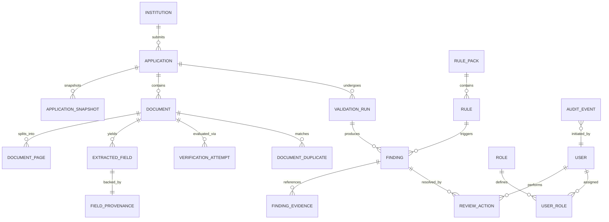

# PRAMAAN-AI: Relational Data Model & Schema Specification

**Document Status:** Approved Architecture Baseline (Planning Only)  
**Version:** 1.0.0  
**Target RDBMS:** PostgreSQL 15+ / 16  
**ORM / Migration Engine:** SQLAlchemy 2.0+ & Alembic  

---

## 1. Entity-Relationship Overview

The database design enforces referential integrity, historical immutability, and reproducible validation runs.

---

## 2. Table Specifications & Constraints

### 2.1 Identity & Access Control

#### `roles`
Defines available system roles.
- `id` (VARCHAR(32), PRIMARY KEY): `institution_user`, `reviewer`, `rules_admin`, `auditor`.
- `description` (VARCHAR(255), NOT NULL).
- `created_at` (TIMESTAMPTZ, NOT NULL, DEFAULT CURRENT_TIMESTAMP).

#### `users`
System actors.
- `id` (UUID, PRIMARY KEY, DEFAULT gen_random_uuid()).
- `username` (VARCHAR(64), UNIQUE, NOT NULL).
- `email` (VARCHAR(255), UNIQUE, NOT NULL).
- `hashed_password` (VARCHAR(255), NOT NULL).
- `full_name` (VARCHAR(128), NOT NULL).
- `institution_id` (UUID, NULL, FK $\to$ `institutions.id` ON DELETE SET NULL).
- `is_active` (BOOLEAN, NOT NULL, DEFAULT TRUE).
- `created_at` (TIMESTAMPTZ, NOT NULL, DEFAULT CURRENT_TIMESTAMP).
- `updated_at` (TIMESTAMPTZ, NOT NULL, DEFAULT CURRENT_TIMESTAMP).

#### `user_roles`
User-role associations.
- `user_id` (UUID, FK $\to$ `users.id` ON DELETE CASCADE).
- `role_id` (VARCHAR(32), FK $\to$ `roles.id` ON DELETE RESTRICT).
- PRIMARY KEY (`user_id`, `role_id`).

---

### 2.2 Institutions & Applications

#### `institutions`
Technical institutes recognized or applying to AICTE.
- `id` (UUID, PRIMARY KEY, DEFAULT gen_random_uuid()).
- `aicte_permanent_id` (VARCHAR(64), UNIQUE, NOT NULL): Official or synthetic AICTE identifier (e.g., `1-3324589110`).
- `name` (VARCHAR(255), NOT NULL).
- `address` (TEXT, NOT NULL).
- `state` (VARCHAR(64), NOT NULL).
- `district` (VARCHAR(64), NOT NULL).
- `institution_type` (VARCHAR(64), NOT NULL): e.g., `GOVERNMENT`, `PRIVATE_UNAIDED`, `UNIVERSITY_MANAGED`.
- `is_synthetic` (BOOLEAN, NOT NULL, DEFAULT TRUE): Visible DEMO indicator.
- `created_at` (TIMESTAMPTZ, NOT NULL, DEFAULT CURRENT_TIMESTAMP).

#### `applications`
Application dossiers submitted for Extension of Approval (EoA) or modifications.
- `id` (UUID, PRIMARY KEY, DEFAULT gen_random_uuid()).
- `application_number` (VARCHAR(64), UNIQUE, NOT NULL): e.g., `APP-2026-EOA-001`.
- `institution_id` (UUID, NOT NULL, FK $\to$ `institutions.id` ON DELETE RESTRICT).
- `academic_year` (VARCHAR(16), NOT NULL): e.g., `2026-2027`.
- `category` (VARCHAR(64), NOT NULL): `EXTENSION_OF_APPROVAL`, `INCREASE_IN_INTAKE`, `NEW_COURSE`, `CLOSURE`.
- `workflow_status` (VARCHAR(32), NOT NULL, DEFAULT 'DRAFT'):
  - Values: `DRAFT`, `PREFLIGHT_DEFICIENT`, `SUBMITTED`, `UNDER_SCRUTINY`, `CLARIFICATION_REQUESTED`, `SCRUTINY_COMPLETED`.
- `declared_data` (JSONB, NOT NULL, DEFAULT '{}'): Declared claims (student count, faculty count, built-up area, intake).
- `created_by` (UUID, NOT NULL, FK $\to$ `users.id`).
- `created_at` (TIMESTAMPTZ, NOT NULL, DEFAULT CURRENT_TIMESTAMP).
- `updated_at` (TIMESTAMPTZ, NOT NULL, DEFAULT CURRENT_TIMESTAMP).
- INDEX: `idx_applications_institution_year` (`institution_id`, `academic_year`).

#### `application_snapshots`
Immutable historical state preserved from prior approved academic years for change-aware review.
- `id` (UUID, PRIMARY KEY, DEFAULT gen_random_uuid()).
- `institution_id` (UUID, NOT NULL, FK $\to$ `institutions.id` ON DELETE CASCADE).
- `academic_year` (VARCHAR(16), NOT NULL): e.g., `2025-2026`.
- `approved_intake` (INTEGER, NOT NULL).
- `approved_programmes` (JSONB, NOT NULL).
- `approved_land_area_sqm` (NUMERIC(10,2), NOT NULL).
- `approved_builtup_area_sqm` (NUMERIC(10,2), NOT NULL).
- `deficiency_history` (JSONB, NOT NULL, DEFAULT '[]').
- `is_synthetic` (BOOLEAN, NOT NULL, DEFAULT TRUE).
- `created_at` (TIMESTAMPTZ, NOT NULL, DEFAULT CURRENT_TIMESTAMP).
- CONSTRAINT: UNIQUE (`institution_id`, `academic_year`).

---

### 2.3 Documents & Document Provenance

#### `documents`
Uploaded binary documents.
- `id` (UUID, PRIMARY KEY, DEFAULT gen_random_uuid()).
- `application_id` (UUID, NOT NULL, FK $\to$ `applications.id` ON DELETE CASCADE).
- `document_type` (VARCHAR(64), NOT NULL):
  - `AFFIDAVIT_GENERAL`, `LAND_USE_CERTIFICATE`, `FIRE_SAFETY_NOC`, `BUILDING_PLAN_ARCHITECT`, `GOVERNING_BODY_RESOLUTION`.
- `original_filename` (VARCHAR(255), NOT NULL).
- `storage_key` (VARCHAR(255), UNIQUE, NOT NULL): Internal filesystem/object store UUID key.
- `file_size_bytes` (INTEGER, NOT NULL).
- `mime_type` (VARCHAR(64), NOT NULL): `application/pdf`, `image/png`, `image/jpeg`.
- `sha256_hash` (CHAR(64), NOT NULL): Binary fingerprint.
- `page_count` (INTEGER, NOT NULL, DEFAULT 1).
- `verification_status` (VARCHAR(32), NOT NULL, DEFAULT 'verification pending'):
  - Exactly one of: `verified`, `mismatch detected`, `expired`, `verification pending`, `source unavailable`, `manual review required`.
- `processing_status` (VARCHAR(32), NOT NULL, DEFAULT 'PROCESSING'): `PENDING`, `PROCESSING`, `PROCESSED`, `FAILED`.
- `created_at` (TIMESTAMPTZ, NOT NULL, DEFAULT CURRENT_TIMESTAMP).
- INDEX: `idx_documents_sha256` (`sha256_hash`).
- INDEX: `idx_documents_application_type` (`application_id`, `document_type`).

#### `document_pages`
Page-level breakdown for navigation and rendering.
- `id` (UUID, PRIMARY KEY, DEFAULT gen_random_uuid()).
- `document_id` (UUID, NOT NULL, FK $\to$ `documents.id` ON DELETE CASCADE).
- `page_number` (INTEGER, NOT NULL): 1-indexed.
- `width_pts` (NUMERIC(8,2), NOT NULL).
- `height_pts` (NUMERIC(8,2), NOT NULL).
- `extracted_text` (TEXT, NULL).
- `ocr_applied` (BOOLEAN, NOT NULL, DEFAULT FALSE).
- CONSTRAINT: UNIQUE (`document_id`, `page_number`).

#### `extracted_fields`
Structured factual attributes parsed from documents.
- `id` (UUID, PRIMARY KEY, DEFAULT gen_random_uuid()).
- `document_id` (UUID, NOT NULL, FK $\to$ `documents.id` ON DELETE CASCADE).
- `field_key` (VARCHAR(64), NOT NULL): e.g., `builtup_area_sqm`, `noc_expiry_date`, `institution_name`, `intake_capacity`.
- `field_value` (TEXT, NOT NULL): Normalized string value.
- `raw_value` (TEXT, NOT NULL): Verbatim string as found in text.
- `data_type` (VARCHAR(32), NOT NULL): `STRING`, `INTEGER`, `NUMERIC`, `DATE`, `BOOLEAN`.
- `confidence` (NUMERIC(4,3), NOT NULL): Score $0.000$ to $1.000$.
- `extraction_method` (VARCHAR(32), NOT NULL): `PDF_TEXT_STREAM`, `TESSERACT_OCR`, `LAYOUT_PARSER`, `MANUAL_ENTRY`.
- `created_at` (TIMESTAMPTZ, NOT NULL, DEFAULT CURRENT_TIMESTAMP).

#### `field_provenances`
Traceable coordinate and region provenance for Explain-Why and PDF viewer overlay.
- `id` (UUID, PRIMARY KEY, DEFAULT gen_random_uuid()).
- `extracted_field_id` (UUID, NOT NULL, FK $\to$ `extracted_fields.id` ON DELETE CASCADE).
- `page_number` (INTEGER, NOT NULL): 1-indexed.
- `bounding_box` (JSONB, NULL): Normalized coordinates `[x1, y1, x2, y2]` where $(0,0)$ is top-left, $(1,1)$ is bottom-right.
- `surrounding_snippet` (TEXT, NULL): Text context surrounding the extracted value.
- `quality_label` (VARCHAR(32), NOT NULL, DEFAULT 'HIGH'): `HIGH`, `MEDIUM`, `LOW_CONFIDENCE`, `UNREADABLE`.
- CONSTRAINT: UNIQUE (`extracted_field_id`).

---

### 2.4 Rules, Validation Runs & Findings

#### `rule_packs`
Versioned collections of regulatory checks tied to APH editions.
- `id` (UUID, PRIMARY KEY, DEFAULT gen_random_uuid()).
- `pack_name` (VARCHAR(128), NOT NULL): e.g., `AICTE APH 2024-2027 Core Rules`.
- `version` (VARCHAR(32), NOT NULL): e.g., `v1.2.0`.
- `category` (VARCHAR(64), NOT NULL): e.g., `EXTENSION_OF_APPROVAL`.
- `effective_from` (DATE, NOT NULL).
- `effective_to` (DATE, NULL).
- `is_active` (BOOLEAN, NOT NULL, DEFAULT FALSE).
- `is_demo` (BOOLEAN, NOT NULL, DEFAULT TRUE): Explicit demonstration flag.
- `created_at` (TIMESTAMPTZ, NOT NULL, DEFAULT CURRENT_TIMESTAMP).
- CONSTRAINT: UNIQUE (`pack_name`, `version`).

#### `rules`
Individual regulatory logic definitions.
- `id` (UUID, PRIMARY KEY, DEFAULT gen_random_uuid()).
- `rule_pack_id` (UUID, NOT NULL, FK $\to$ `rule_packs.id` ON DELETE CASCADE).
- `rule_code` (VARCHAR(64), NOT NULL): e.g., `RULE-APH-002`.
- `title` (VARCHAR(255), NOT NULL).
- `clause_citation` (VARCHAR(255), NOT NULL): e.g., `AICTE APH 2024-27 Clause 4.2(b)`.
- `condition_definition` (JSONB, NOT NULL): Declarative condition criteria.
- `severity` (VARCHAR(32), NOT NULL): `DEFICIENCY`, `ANOMALY_SIGNAL`, `OBSERVATION`.
- `explanation_template` (TEXT, NOT NULL): Formatted markdown string.
- `remediation_hint` (TEXT, NOT NULL): Actionable advice for institution or reviewer.
- CONSTRAINT: UNIQUE (`rule_pack_id`, `rule_code`).

#### `validation_runs`
Immutable execution records of rule packs against an application snapshot.
- `id` (UUID, PRIMARY KEY, DEFAULT gen_random_uuid()).
- `application_id` (UUID, NOT NULL, FK $\to$ `applications.id` ON DELETE CASCADE).
- `rule_pack_id` (UUID, NOT NULL, FK $\to$ `rule_packs.id` ON DELETE RESTRICT).
- `executed_at` (TIMESTAMPTZ, NOT NULL, DEFAULT CURRENT_TIMESTAMP).
- `executed_by` (UUID, NOT NULL, FK $\to$ `users.id`).
- `input_snapshot` (JSONB, NOT NULL): Exact extracted fields and application declarations consumed.
- `overall_result` (VARCHAR(32), NOT NULL): `PASSED`, `DEFICIENCIES_DETECTED`, `INCONCLUSIVE`.

#### `findings`
Discrete evaluations produced by a validation run.
- `id` (UUID, PRIMARY KEY, DEFAULT gen_random_uuid()).
- `validation_run_id` (UUID, NOT NULL, FK $\to$ `validation_runs.id` ON DELETE CASCADE).
- `rule_id` (UUID, NOT NULL, FK $\to$ `rules.id` ON DELETE RESTRICT).
- `status` (VARCHAR(32), NOT NULL): `COMPLIANT`, `DEFICIENCY`, `ANOMALY_SIGNAL`, `INCONCLUSIVE`.
- `reason` (TEXT, NOT NULL): Human-readable explanation.
- `recommended_action` (TEXT, NOT NULL): Next action for officer.
- `created_at` (TIMESTAMPTZ, NOT NULL, DEFAULT CURRENT_TIMESTAMP).

#### `finding_evidences`
Links findings directly to supporting extracted fields, documents, or baseline records.
- `id` (UUID, PRIMARY KEY, DEFAULT gen_random_uuid()).
- `finding_id` (UUID, NOT NULL, FK $\to$ `findings.id` ON DELETE CASCADE).
- `extracted_field_id` (UUID, NULL, FK $\to$ `extracted_fields.id` ON DELETE SET NULL).
- `document_id` (UUID, NULL, FK $\to$ `documents.id` ON DELETE SET NULL).
- `comparison_value` (TEXT, NULL): Value compared against (e.g., historical approved intake).
- `comparison_source` (VARCHAR(128), NULL): Source of comparison value (e.g., `AICTE Historical DB 2025-26`).

---

### 2.5 Verification Ladder & Review Actions

#### `verification_attempts`
Records every external authentication attempt.
- `id` (UUID, PRIMARY KEY, DEFAULT gen_random_uuid()).
- `document_id` (UUID, NOT NULL, FK $\to$ `documents.id` ON DELETE CASCADE).
- `adapter_name` (VARCHAR(64), NOT NULL): e.g., `SIMULATED_STATE_FIRE_SERVICE_ADAPTER`.
- `is_simulated` (BOOLEAN, NOT NULL, DEFAULT TRUE).
- `request_reference` (VARCHAR(128), NOT NULL): Reference ID / certificate number queried.
- `status` (VARCHAR(32), NOT NULL):
  - Exactly one of: `verified`, `mismatch detected`, `expired`, `verification pending`, `source unavailable`, `manual review required`.
- `response_payload` (JSONB, NOT NULL, DEFAULT '{}'): Sanitized external response.
- `error_message` (TEXT, NULL).
- `attempted_at` (TIMESTAMPTZ, NOT NULL, DEFAULT CURRENT_TIMESTAMP).
- `attempted_by` (UUID, NOT NULL, FK $\to$ `users.id`).

#### `review_actions`
Auditable human decisions taken by scrutiny officers on findings or documents.
- `id` (UUID, PRIMARY KEY, DEFAULT gen_random_uuid()).
- `finding_id` (UUID, NOT NULL, FK $\to$ `findings.id` ON DELETE CASCADE).
- `actor_id` (UUID, NOT NULL, FK $\to$ `users.id`).
- `action_type` (VARCHAR(32), NOT NULL):
  - `CONFIRM_DEFICIENCY`, `DISMISS_DEFICIENCY`, `REQUEST_RECTIFICATION`, `RECOMMEND_INSPECTION`, `MANUAL_VERIFY`.
- `justification_reason` (TEXT, NOT NULL).
- `action_timestamp` (TIMESTAMPTZ, NOT NULL, DEFAULT CURRENT_TIMESTAMP).

---

### 2.6 Duplication & Tamper-Evident Audit Trail

#### `document_duplicates`
Cross-application document similarity records.
- `id` (UUID, PRIMARY KEY, DEFAULT gen_random_uuid()).
- `document_a_id` (UUID, NOT NULL, FK $\to$ `documents.id` ON DELETE CASCADE).
- `document_b_id` (UUID, NOT NULL, FK $\to$ `documents.id` ON DELETE CASCADE).
- `match_method` (VARCHAR(32), NOT NULL): `EXACT_SHA256`, `NORMALIZED_TEXT_HASH`, `PERCEPTUAL_IMAGE_HASH`.
- `similarity_score` (NUMERIC(4,3), NOT NULL): $1.000$ for exact hash.
- `is_reviewed` (BOOLEAN, NOT NULL, DEFAULT FALSE).
- `created_at` (TIMESTAMPTZ, NOT NULL, DEFAULT CURRENT_TIMESTAMP).
- CONSTRAINT: UNIQUE (`document_a_id`, `document_b_id`).

#### `audit_events`
Cryptographically hash-chained append-only log.
- `sequence_number` (BIGSERIAL, PRIMARY KEY).
- `event_id` (UUID, UNIQUE, NOT NULL, DEFAULT gen_random_uuid()).
- `timestamp` (TIMESTAMPTZ, NOT NULL, DEFAULT CURRENT_TIMESTAMP).
- `actor_id` (UUID, NOT NULL, FK $\to$ `users.id`).
- `actor_role` (VARCHAR(32), NOT NULL).
- `event_type` (VARCHAR(64), NOT NULL): e.g., `DOCUMENT_UPLOADED`, `VALIDATION_RUN_EXECUTED`, `FINDING_CONFIRMED`, `VERIFICATION_QUERIED`.
- `entity_type` (VARCHAR(64), NOT NULL): e.g., `Application`, `Document`, `Finding`.
- `entity_id` (UUID, NOT NULL).
- `payload_hash` (CHAR(64), NOT NULL): SHA-256 of the event details JSON string.
- `previous_event_hash` (CHAR(64), NOT NULL): Hash of the preceding audit row ($000...000$ for genesis block).
- `current_event_hash` (CHAR(64), NOT NULL): SHA-256 of (`previous_event_hash` + `timestamp` + `actor_id` + `event_type` + `payload_hash`).
- INDEX: `idx_audit_events_current_hash` (`current_event_hash`).
