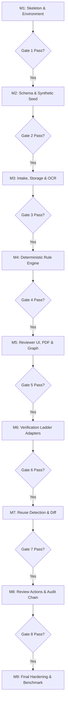

# PRAMAAN-AI: Dependency-Ordered Implementation Plan & Milestone Gates

**Document Status:** Approved Architecture Baseline (Planning Only)  
**Version:** 1.0.0  
**Methodology:** Incremental Monolith Construction with Human Checkpoint Gates  

---

## 1. Master Milestone Roadmap

---

## 2. Milestone Specifications & Acceptance Gates

### Milestone 1: Repository Foundation, Tooling & Application Shell
- **Objective:** Establish the modular monorepo (`frontend/`, `backend/`), configuration management, testing frameworks, and runnable baseline shell.
- **Deliverables:**
  - `backend/`: FastAPI application, configuration loader (`.env.example`), health endpoints (`GET /health`, `GET /health/ready`), Pytest setup.
  - `frontend/`: React + TypeScript + Vite + Tailwind setup, application shell with persistent `DEMO / SIMULATED` banner.
  - `docker-compose.yml` for local reproducibility.
- **Acceptance Gate 1:**
  - `GET /health` returns `{"status": "healthy", "is_demo_mode": true}`.
  - Frontend builds cleanly (`npm run build`) and renders landing page without console errors.
  - No secret keys committed.

---

### Milestone 2: Relational Data Model, Migrations & Synthetic Seed
- **Objective:** Implement PostgreSQL schemas using SQLAlchemy 2.0 and Alembic migrations, followed by repeatable synthetic data seeding.
- **Deliverables:**
  - Models: `users`, `institutions`, `applications`, `documents`, `extracted_fields`, `rule_packs`, `rules`, `validation_runs`, `findings`, `audit_events`.
  - Alembic migration scripts.
  - Seed CLI command (`python -m app.cli seed-demo-data`) creating 1 clean institution and 1 flawed institution.
- **Acceptance Gate 2:**
  - Fresh database migrations apply cleanly (`alembic upgrade head`).
  - Seeding is idempotent (re-running seed does not duplicate records or violate unique constraints).
  - Relationship tests pass with 100% integrity.

---

### Milestone 3: Secure Document Intake, File Isolation & OCR Provenance
- **Objective:** Implement secure file upload, magic byte validation, protected storage, and text extraction with bounding boxes.
- **Deliverables:**
  - `POST /applications/{id}/documents` with 25MB cap, magic byte verification, and SHA-256 calculation.
  - Document parser prioritizing embedded text with Tesseract OCR fallback.
  - Bounding box normalization and extraction quality confidence scoring.
- **Acceptance Gate 3:**
  - Malicious / invalid files (e.g., `.exe` renamed to `.pdf`) are rejected with HTTP 400.
  - Extracted fields retain exact document ID, page number, and bounding box coordinates.
  - Low-quality or degraded pages abstain rather than hallucinating values.

---

### Milestone 4: Deterministic Rules Engine & Run Persistence
- **Objective:** Build the versioned rule execution engine and immutable run snapshotter.
- **Deliverables:**
  - Rule packs for APH 2024–2027 (`RULE-APH-001` through `RULE-APH-006`).
  - Validation run service storing input snapshots, findings, and evidence references.
  - Comprehensive unit tests covering pass, fail, boundary dates, and missing fields.
- **Acceptance Gate 4:**
  - Validation runs are fully reproducible from persisted snapshots.
  - Missing documents trigger `DEFICIENCY` findings citing exact APH clauses.
  - Every finding links directly to at least one evidence item or explicitly states evidence is unavailable.

---

### Milestone 5: Case File UI, PDF Viewer, Explain-Why & Evidence Graph
- **Objective:** Implement the officer workstation, interactive PDF viewer, and visual graph.
- **Deliverables:**
  - Reviewer queue with deficiency filters.
  - Case detail view with PDF.js viewer rendering highlight boxes on extracted coordinates.
  - Explain-Why panel displaying side-by-side values and handbook citations.
  - Cytoscape.js Evidence Graph connecting claims, rules, and findings with accessible table fallback.
- **Acceptance Gate 5:**
  - Clicking any finding automatically opens the PDF viewer to the correct page and highlights the evidence box.
  - UI works without console errors and provides responsive fallbacks when coordinates are absent.

---

### Milestone 6: Verification Ladder & Simulated Issuer Adapters
- **Objective:** Create the provider-agnostic verification interface and simulated issuer services.
- **Deliverables:**
  - `POST /documents/{id}/verification-attempts` supporting all 6 exact states:
    `verified`, `mismatch detected`, `expired`, `verification pending`, `source unavailable`, `manual review required`.
  - Simulated State Fire Service and Registrar adapters with deterministic responses.
  - Digital signature verification utility.
- **Acceptance Gate 6:**
  - Simulating an issuer timeout returns `source unavailable` and does **not** fail the applicant's compliance status.
  - Realized verification attempts are logged to the audit trail.

---

### Milestone 7: Cross-Application Reuse Detection & Change-Aware Review
- **Objective:** Implement SHA-256 deduplication and historical snapshot diffing.
- **Deliverables:**
  - Exact file match detection across different institutions.
  - Prior-year baseline comparison UI showing intake changes side-by-side.
- **Acceptance Gate 7:**
  - Document reuse is labeled as a preliminary review signal, **never as proof of fraud**.
  - Legitimate institution name variations are flagged for human confirmation without automated penalties.

---

### Milestone 8: Human Review Actions, RBAC & Hash-Chained Audit Trail
- **Objective:** Implement officer scrutiny decision-making and tamper-evident audit logging.
- **Deliverables:**
  - Scrutiny actions: `CONFIRM_DEFICIENCY`, `DISMISS_DEFICIENCY`, `REQUEST_RECTIFICATION`.
  - FastAPI backend RBAC dependency enforcing permissions on all routes.
  - Cryptographic hash chain over all audit events with `POST /audit/verify-chain`.
- **Acceptance Gate 8:**
  - Unprivileged roles cannot access reviewer or admin endpoints.
  - Deliberately modifying a test audit row causes chain verification to fail and identifies the exact sequence number.

---

### Milestone 9: Final Integration Sweep, Benchmark & Release Readiness
- **Objective:** Execute the 12 synthetic benchmark bundles, conduct negative security testing, and produce the release readiness report.
- **Deliverables:**
  - Full automated test run (unit, integration, frontend, e2e).
  - `docs/RELEASE_READINESS.md` documenting verified benchmark metrics, limitations, and demo reproduction steps.
- **Acceptance Gate 9:**
  - 100% of benchmark fixtures behave as specified in the test plan.
  - Clean local setup succeeds from scratch using only documented commands.
