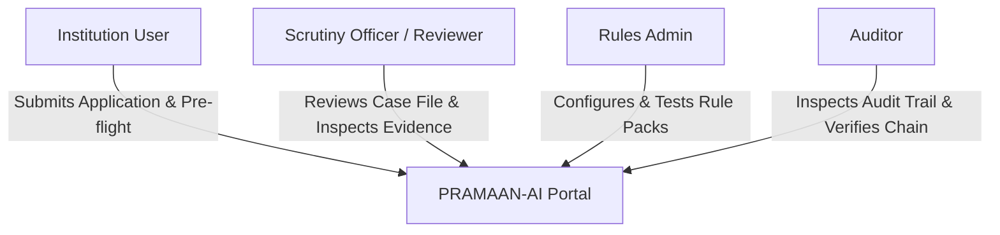
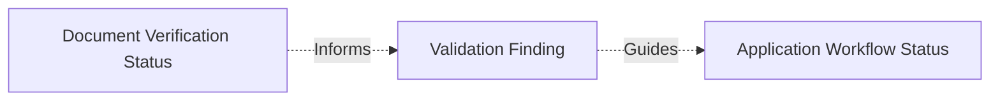

# PRAMAAN-AI: Product Requirements Document (PRD)

**Project Name:** PRAMAAN-AI  
**Problem Statement ID:** SIH26261 — AI-Powered Application Validation, Document Authentication and Regulatory Compliance Verification  
**Organization:** All India Council for Technical Education (AICTE), Ministry of Education  
**Document Status:** Approved Architecture Baseline (Planning Only)  
**Version:** 1.0.0  

---

## 1. Executive Summary & Product Thesis

PRAMAAN-AI is an evidence-first, human-in-the-loop decision-support copilot designed for AICTE scrutiny officers and institutional applicants. Processing thousands of Extension of Approval (EoA) and institutional change applications annually requires evaluating complex submissions against the AICTE Approval Process Handbook (APH), cross-checking prior institutional approvals, and authenticating documentary evidence.

### Core Philosophy
1. **Decision Support, Not Decision Authority:** The system never autonomously approves, rejects, or accuses an institution of fraud. Final regulatory decisions, scrutiny outcomes, and physical inspection mandates remain exclusively with authorized AICTE officials.
2. **Every Flag Backed by Traceable Evidence:** Every finding connects an extracted claim, its exact page/bounding box, the versioned regulatory rule or reference record, and a recommended human action.
3. **Product Truth & Honest Uncertainty:** If a document is unreadable or an issuer API is offline, the system abstains and reports `manual review required` or `source unavailable`. It never transforms a technical failure into an applicant violation.
4. **Synthetic Data Baseline:** For prototype and SIH demonstration purposes, all external records, issuer portals, and application bundles are synthetic and visibly labeled `DEMO / SIMULATED`.

---

## 2. User Roles & Personas

The platform defines four primary user roles enforced via backend Role-Based Access Control (RBAC):

### 2.1 Institution User (`institution_user`)
- **Profile:** College Principal, Registrar, or authorized administrative representative submitting an EoA or approval modification.
- **Goals:**
  - Create synthetic application bundles.
  - Upload supporting PDFs (Affidavits, Land Use Certificates, Fire NOCs, Governing Body Resolutions, Architect Certificates).
  - Run **pre-flight validation** to identify missing fields, expired certificates, or discrepancies before formal submission, reducing deficiency rounds.
- **Constraints:** Cannot view internal scrutiny queues, officer notes, or other institutions' submissions.

### 2.2 Scrutiny Officer / Reviewer (`reviewer`)
- **Profile:** AICTE regional or central scrutiny officer reviewing application bundles.
- **Goals:**
  - Work from a prioritized queue of applications filtered by deficiency status.
  - Inspect application case files with side-by-side PDF viewer and extracted evidence highlights.
  - Traverse the **Evidence Graph** to understand relationships between claims, rules, and documents.
  - Execute issuer verification attempts via the **Verification Ladder**.
  - Record scrutiny actions: `Confirm Finding`, `Dismiss Finding (with justification)`, `Request Rectification / Clarification`, or `Recommend On-Site Inspection`.
- **Constraints:** Cannot alter versioned regulatory rule configurations.

### 2.3 Rules Administrator (`rules_admin`)
- **Profile:** AICTE regulatory policy specialist or system administrator managing compliance criteria.
- **Goals:**
  - View and author versioned, effective-dated regulatory rule packs tied to specific APH clauses.
  - Run "Test-Before-Activate" simulations against historical/synthetic test suites.
  - Activate validated rule packs without requiring software redeployment.
- **Constraints:** Cannot modify existing historical validation runs (immutability).

### 2.4 Auditor (`auditor`)
- **Profile:** Compliance auditor, vigilance officer, or senior authority overseeing scrutiny integrity.
- **Goals:**
  - Review the complete, append-only audit trail of rules applied, documents scrutinized, issuer responses, and officer decisions.
  - Trigger one-click cryptographic hash-chain verification (`POST /audit/verify-chain`) to detect any data tampering.
- **Constraints:** Read-only access to case files and logs; cannot record scrutiny decisions.

---

## 3. Product Scope: MVP vs. Explicitly Deferred Features

| Functional Area | In Scope for SIH Prototype (MVP) | Explicitly Deferred to Production Roadmap |
|---|---|---|
| **Intake & Classification** | PDF & Image intake, MIME magic validation, safe storage, SHA-256 fingerprinting, layout-aware text extraction. | High-throughput distributed ingestion queue; automated intake of CAD floorplans. |
| **OCR & Text Extraction** | Embedded PDF text extraction + Tesseract OCR fallback for scanned pages with bounding boxes. | Multilingual Indic OCR training; handwriting analysis. |
| **Rule Engine** | Deterministic, effective-dated rule packs (APH completeness, expiry, land norms, FSR, intake limits) with reproducible runs. | Natural language rule synthesis; autonomous rule generation. |
| **Evidence Presentation** | Interactive Evidence Graph, Explain-Why panel, PDF viewer with box overlays and coordinate fallback. | 3D campus infrastructure reconstruction. |
| **Issuer Verification** | Provider-agnostic Verification Ladder with deterministic simulated issuer adapter returning all 6 honest states. | Live production integration with state registrar portals or DigiLocker. |
| **Deduplication** | Exact SHA-256 cross-application match + normalized text fingerprinting; labelled as preliminary similarity. | Distributed FAISS vector search across millions of historical blueprints. |
| **Compliance Vision** | Metadata checks, resolution/exif verification, and simulated room count checklist. | Live YOLO/Grounding DINO inference server for live video inspection. |
| **Audit & Security** | Cryptographic hash-chained audit logging, tamper-detection verification, RBAC permissions on all endpoints. | Hardware Security Module (HSM) signing; enterprise Active Directory SSO. |

---

## 4. Status Taxonomy & Separation of Concerns

A foundational design rule of PRAMAAN-AI is the strict distinction between three orthogonal states:

### 4.1 Document Verification Status (Exact 6 States)
Every uploaded document evaluated against external sources receives exactly one verification state:
1. `verified`: Cryptographically confirmed via digital signature, valid issuer QR, or authorized issuer registry match.
2. `mismatch detected`: Source returned definitive records that contradict the submitted document.
3. `expired`: The document's validity period lapsed prior to the application cutoff date.
4. `verification pending`: An asynchronous check is queued or awaiting issuer response.
5. `source unavailable`: The issuing portal, registry, or simulated adapter is unreachable or timed out. *(This never causes a compliance rejection)*.
6. `manual review required`: Document is low-quality, ambiguous, or lacks an automated verification path.

### 4.2 Validation Finding Status
Individual rule evaluations generate distinct findings with severities:
- `COMPLIANT`: Rule criteria completely satisfied with verifiable evidence.
- `DEFICIENCY`: Required document missing, expired, or norm breached (e.g., FSR deficit).
- `ANOMALY_SIGNAL`: Unconfirmed discrepancy, duplicate document reuse, or metadata irregularity flagged for human review.
- `INCONCLUSIVE`: Insufficient extraction quality or source unavailable; system abstained from making an evaluation.

### 4.3 Application Workflow Status
The overall administrative progression of the institutional case file:
- `DRAFT`: In preparation by institution.
- `PREFLIGHT_DEFICIENT`: Pre-submission check identified deficiencies.
- `SUBMITTED`: Formally lodged for AICTE scrutiny.
- `UNDER_SCRUTINY`: Officer actively inspecting evidence and findings.
- `CLARIFICATION_REQUESTED`: Officer routed inquiries back to the institution.
- `SCRUTINY_COMPLETED`: Officer finalized recommendations; case packaged for competent authority decision.

---

## 5. Functional Requirements Mapped to SIH26261

| Module | Problem Statement Requirement | PRAMAAN-AI Feature Implementation |
|---|---|---|
| **M1: Intelligent Validation** | Validate applications & documents against institutional records & APH rules; identify missing/expired data. | Category-specific rule packs, structured field extraction with page coordinates, automated completeness & validity evaluation. |
| **M2: Anomaly & Reuse Signals** | Detect potential document alterations, reuse, metadata inconsistencies, and mismatched identifiers. | Cross-application SHA-256 & text similarity deduplication, date/number sanity checks, preliminary indicator labeling. |
| **M3: Issuing Authority Verification** | Direct verification via APIs, digital signatures, QR codes, or reference lookups across 6 explicit states. | Verification Ladder adapter interface supporting digital signature parsing, simulated registry lookup, and graceful error handling. |
| **M4: Infrastructure Compliance Assistance** | Compare submitted infrastructure evidence against configurable checklists; flag inspection needs. | Floor area & laboratory norm calculators with clear advisory flags recommending on-site physical verification. |
| **M5: Dashboard, Alerts & Audit Trail** | Centralized dashboard, real-time deficiency alerts, transparent decision support, and tamper-evident audit logs. | Reviewer queue, Evidence Graph, Explain-Why panel, and SHA-256 hash-chained audit log with one-click tamper verification. |

---

## 6. Regulatory Traceability & Handbooks

All regulatory checks implemented in the prototype are either:
1. Grounded in specific clauses of the **AICTE Approval Process Handbook (APH 2024–2027)** (e.g., Table 4.1 for Land Requirements, Table 7.1 for Faculty Cadre Ratio), citing chapter, clause, and table numbers; OR
2. Explicitly tagged as `DEMO_RULE` in UI banners and API schemas.
No rule or compliance standard is generated or decided autonomously by a language model.
