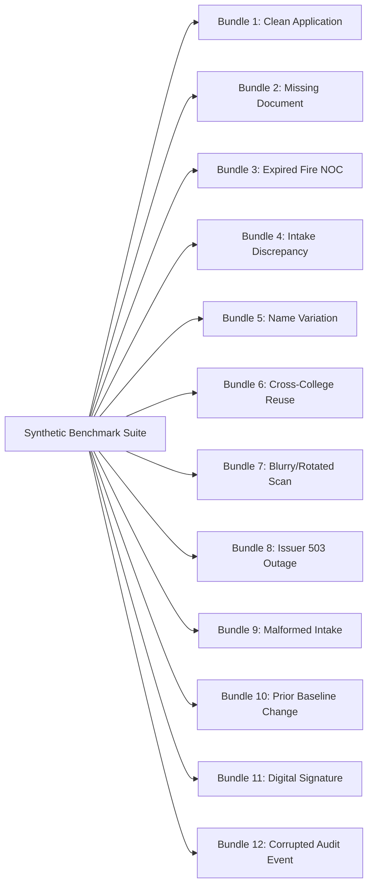

# PRAMAAN-AI: Comprehensive Quality Assurance & Synthetic Test Plan

**Document Status:** Approved Architecture Baseline (Planning Only)  
**Version:** 1.0.0  
**Test Frameworks:** Pytest (Backend API & Rules) | Vitest & Playwright (Frontend Components & E2E)  
**Core Benchmark:** 12 Labelled Synthetic Application Bundles  

---

## 1. Quality Philosophy: Labelled Benchmark vs. Unsupported Claims

In conformance with [AGENTS.md](file:///c:/Users/Anwar%20Jehan%20Begum/OneDrive/Desktop/pramaan-ai/AGENTS.md), PRAMAAN-AI reports test results and accuracy metrics **only from executed, reproducible benchmarks**. No speculative or aspirational percentages are reported as current system performance.

Every test fixture is deterministic, fully synthetic, and accompanied by an explicit ground-truth outcome file.

---

## 2. The 12 Synthetic Demonstration Benchmark Bundles



### Detailed Fixture Catalog & Expected Outcomes

| Bundle # | Scenario Description | Injected Condition | Expected Document Status | Expected Finding Status | Expected Next Action |
|:---:|---|---|---|---|---|
| **01** | **Clean Submission** | All 5 mandatory documents valid; FSR is 1:15; built-up area exceeds norm. | `verified` | `COMPLIANT` | Recommend case for standard approval review. |
| **02** | **Missing Mandatory Document** | `AFFIDAVIT_GENERAL` omitted from uploaded bundle. | N/A (Missing) | `DEFICIENCY` (RULE-APH-001) | Pre-flight alert: Upload mandatory general affidavit. |
| **03** | **Expired Fire NOC** | Fire NOC with validity ending `2024-01-14` (prior to academic cutoff). | `expired` | `DEFICIENCY` (RULE-APH-002) | Request current valid Fire Safety Certificate. |
| **04** | **Cross-Document Intake Mismatch** | Application claims intake 240, but Architect Certificate indicates capacity for 180. | `verified` | `DEFICIENCY` (RULE-APH-003) | Flag intake disparity; inspect physical space evidence. |
| **05** | **Legitimate Name Variation** | "Apex Inst. of Tech." on Land Deed vs. "Apex Institute of Technology" on Master. | `verified` | `ANOMALY_SIGNAL` (RULE-APH-006) | Reviewer confirms entity identity match; no penalty. |
| **06** | **Cross-Application Document Reuse** | Identical Land Use Certificate uploaded by two different colleges. | `verified` | `ANOMALY_SIGNAL` (RULE-APH-007) | Flag duplicate file; review both dossiers side-by-side. |
| **07** | **Degraded / Skewed Scan** | Fire NOC scanned at 50 DPI with heavy skew; text unreadable. | `manual review required` | `INCONCLUSIVE` | System abstains; routes to manual visual scrutiny. |
| **08** | **Mock Issuer Down (503)** | Simulated Fire Service API returns timeout/503 during verification. | `source unavailable` | `INCONCLUSIVE` (Verification) | Do not fail compliance; schedule retry or manual check. |
| **09** | **Malformed Upload Attempt** | File with `.pdf` extension containing an executable binary header. | Rejected at HTTP boundary | N/A | Return 400 Bad Request: Invalid file signature. |
| **10** | **Historical Baseline Change** | Intake increased from 180 to 240 in an EoA without increase approval. | `verified` | `ANOMALY_SIGNAL` (RULE-APH-005) | Require official AICTE increase sanction order. |
| **11** | **Digital Signature Verification** | PDF with valid self-contained PKCS#7 digital signature. | `verified` | `COMPLIANT` | Display certificate details (Signer, CN, Timestamp). |
| **12** | **Tampered Audit Event** | Disposable DB test row manually altered in `payload_hash`. | N/A | `CHAIN_BROKEN` | `POST /audit/verify-chain` flags exact sequence #. |

---

## 3. Test Suites & Execution Architecture

### 3.1 Backend Test Structure (`backend/tests/`)
- `tests/unit/test_ingestion_security.py`: Tests magic byte sniffing, path traversal sanitization, size limits, and page count caps.
- `tests/unit/test_rules_engine.py`: Tests all 7 APH rules against isolated fixtures (pass, fail, boundary dates, missing fields).
- `tests/unit/test_audit_hash_chain.py`: Tests hash generation, linear chaining, and deliberate row corruption detection.
- `tests/integration/test_verification_ladder.py`: Verifies provider-agnostic adapter handling all 6 honest statuses and network timeouts.
- `tests/integration/test_api_rbac.py`: Proves role-based access control enforces permissions on backend endpoints.

### 3.2 Frontend Test Structure (`frontend/tests/`)
- `tests/components/PdfViewer.test.tsx`: Tests PDF.js page navigation, bounding box highlight calculation, and coordinate-free fallback.
- `tests/components/EvidenceGraph.test.tsx`: Tests Cytoscape.js graph rendering, node selection, and accessible table fallback.
- `tests/components/ExplainWhyPanel.test.tsx`: Tests display of rule citation, evidence snippets, and reviewer actions.

### 3.3 End-to-End Browser Workflows (Playwright)
- `tests/e2e/test_reviewer_case_flow.spec.ts`:
  1. Login as `reviewer`.
  2. Navigate to Reviewer Queue.
  3. Open Case `APP-2026-EOA-108`.
  4. Click finding `RULE-APH-002` (Expired Fire NOC).
  5. Confirm PDF viewer navigates to Page 1 and highlights expiry date.
  6. Trigger simulated issuer verification $\to$ observe `expired` status.
  7. Submit review action `CONFIRM_DEFICIENCY`.
  8. Navigate to Audit Log $\to$ click "Verify Audit Chain" $\to$ observe `Chain Valid`.

---

## 4. Exact Execution Commands (Windows & Linux)

### Backend Test Execution
```powershell
# Run all backend unit and integration tests with coverage
cd backend
pytest -v --cov=app --cov-report=term-missing

# Run specific security & rule engine tests
pytest tests/unit/test_rules_engine.py -v
pytest tests/unit/test_ingestion_security.py -v
pytest tests/unit/test_audit_hash_chain.py -v
```

### Frontend Type-Check, Lint & Tests
```powershell
# Run frontend type checking, lint, and component tests
cd frontend
npm run typecheck
npm run lint
npm run test:unit
```

### End-to-End Browser Verification
```powershell
cd frontend
npx playwright test
```
