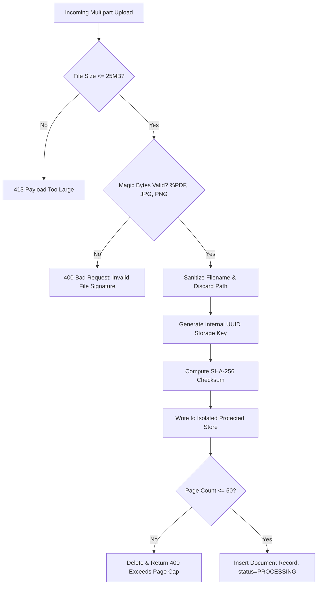

# PRAMAAN-AI: Threat Model, Security Controls & Data Protection

**Document Status:** Approved Architecture Baseline (Planning Only)  
**Version:** 1.0.0  
**Security Methodology:** STRIDE Threat Modeling & Defense-in-Depth  
**Compliance Alignment:** Digital Personal Data Protection (DPDP) Act 2023 & IT Act 2000  

---

## 1. Threat Modeling (STRIDE Analysis)

| Threat (STRIDE) | Threat Description | Attack Vector / Scenario | PRAMAAN-AI Countermeasure |
|---|---|---|---|
| **Spoofing** | Attacker impersonates an AICTE scrutiny officer or another institution. | Token forging or session hijacking to access unowned applications. | Backend JWT validation, HTTPS-only secure cookies, scoped institution ID checks on every entity query. |
| **Tampering** | Rogue actor or compromised account modifies an audit event or past finding. | Direct database row update to erase a deficiency or falsify an approval record. | Cryptographic hash chaining ($H_i = \text{SHA256}(H_{i-1} \parallel \dots)$). Chain verification (`POST /audit/verify-chain`) immediately exposes altered sequence items. |
| **Repudiation** | Scrutiny officer denies having confirmed or dismissed a deficiency. | Disputed scrutiny action during subsequent vigilance audit. | Append-only `review_actions` table tied to actor UUID, client IP, timestamp, and signed audit event. |
| **Information Disclosure** | Unauthorized extraction of applicant confidential financial records, PAN, or land deeds. | Insecure Direct Object Reference (IDOR) on `/documents/{id}` or directory traversal via file upload. | Server-side UUID storage keys, no direct filesystem paths exposed in API, RBAC ownership checks on all document routes. |
| **Denial of Service** | Resource exhaustion via decompression bombs, multi-gigabyte uploads, or complex OCR loops. | Malicious 10,000-page PDF or zip bomb uploaded to intake endpoint. | File size limit (25MB), page count cap (50 pages), magic-byte validation, async background worker resource timeouts. |
| **Elevation of Privilege** | Institution user executes administrative rule pack changes or scrutiny sign-offs. | Invoking `/rule-packs/{id}/activate` or `/findings/{id}/review-actions` directly. | Enforced FastAPI dependency injection verifying `RoleChecker(["rules_admin"])` on backend routes; UI button hiding is never the sole gate. |

---

## 2. Secure Document Intake & File Isolation Architecture

Document intake represents the highest attack surface for malicious payloads. The ingestion pipeline follows a strict isolation protocol:

### Specific Intake Controls
1. **Magic Header Inspection:** File headers are inspected using `python-magic` or direct binary slicing:
   - PDF: Starts with `%PDF-` (`0x25 0x50 0x44 0x46 0x2D`)
   - JPEG: Starts with `\xFF\xD8\xFF`
   - PNG: Starts with `\x89PNG\r\n\x1a\n`
   Files with executable extensions, SVG (potential XSS), HTML, or mismatching magic bytes are rejected unconditionally.
2. **Path Traversal Immunity:** Client-provided filenames (e.g., `../../etc/passwd` or `C:\Windows\System32`) are completely stripped using `os.path.basename()` and never used on disk. Storage paths are exclusively generated as:
   $$\text{Path} = \text{STORAGE\_ROOT} / \text{tenant\_uuid} / \{\text{document\_uuid}\}.\text{bin}$$
3. **No Execution Permissions:** Upload storage partitions are mounted with `noexec` flags in production environments.

---

## 3. Cryptographic Hash-Chained Audit Ledger

To provide tamper-evident auditing without the complexity or environmental overhead of an external blockchain, PRAMAAN-AI implements a cryptographic hash chain within PostgreSQL.

### Mathematical Hash-Chain Specification
For event sequence $i$:
$$H_0 = \text{"0000000000000000000000000000000000000000000000000000000000000000"}$$
$$H_i = \text{SHA256}\left(H_{i-1} \parallel \text{Timestamp}_i \parallel \text{ActorID}_i \parallel \text{EventType}_i \parallel \text{EntityID}_i \parallel \text{PayloadHash}_i\right)$$

Where:
- $\parallel$ denotes string concatenation with a delimiter (`|`).
- $\text{PayloadHash}_i$ is the canonical JSON SHA-256 of the event details.
- $H_i$ is recorded as `current_event_hash` in `audit_events`.

### Verification Logic & Threat Boundary
- **Integrity Verification:** The audit service re-computes the hash chain sequentially from $i = 1$ to $N$. If $H_k \neq \text{StoredHash}_k$, the engine immediately reports tampering at sequence $k$ with the offending event ID.
- **Threat Boundary Disclosure:** Hash chaining within the application database reliably detects unauthorized row modifications, row deletions, or localized updates by application actors or SQL injection. It **does not protect** against a fully compromised, privileged database superuser (`postgres`) who maliciously recalculates the entire chain from the corrupted point forward. For production deployment, periodic checkpoint hashes will be published to a write-once read-many (WORM) storage bucket or an external timestamping authority.

---

## 4. Privacy & Personal Data Protection (DPDP Act 2023 Alignment)

1. **Synthetic Data Policy:** The SIH prototype operates exclusively on synthetic data. No real student records, faculty Aadhaar numbers, or bank account statements are stored or processed.
2. **Sensitive Identifier Masking:** Where synthetic documents contain identifiers (e.g., synthetic Aadhaar, PAN, phone numbers), the extraction service automatically masks all but the last 4 digits (e.g., `XXXX-XXXX-4812`).
3. **Protected Viewer Access:** The PDF evidence viewer serves document page images via authenticated backend proxies (`/documents/{id}/pages/{page}/view`). Direct, unauthenticated file URLs are never exposed.
4. **Data Retention & Disposal:** Synthetic test dossiers can be completely purged through cascading database foreign keys and safe file removal procedures.
