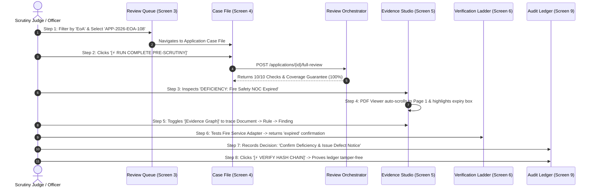

# PRAMAAN-AI: UI/UX Design Specification & Design System
**High-Trust Regulatory Decision-Support Workspace for AICTE Scrutiny**

- **Document ID:** `SPEC-UIUX-001`
- **Version:** `1.0.0`
- **Status:** Approved UI/UX Design Baseline (Design Specification Only — No Code Changes)
- **Target Audience:** Frontend Engineers, UX Reviewers, SIH Evaluators, AICTE Scrutiny Committee
- **Problem Statement:** SIH26261 — AI-Powered Application Validation, Document Authentication and Regulatory Compliance Verification

---

## 1. Executive Summary & Design Philosophy

### 1.1 Core Product Thesis
> *"Every flag backed by evidence. Every decision stays human."*

PRAMAAN-AI is not an automated approval or rejection engine, nor is it a black-box AI judge. It is an **evidence-first decision-support copilot** purpose-built for the All India Council for Technical Education (AICTE). 

Annually, AICTE scrutiny officers process thousands of Extension of Approval (EoA) and institutional modification dossiers. Naive digital tools overwhelm officers with disconnected tables or obscure automated flags. Generic "AI admin templates" with glowing neon gradients, dark glassmorphism, or cartoonish counters erode credibility with senior regulatory officers and vigilance committees.

PRAMAAN-AI establishes an authoritative, calm, and rigorous digital workspace inspired by classic institutional legal registers, premium judicial workstations, and aviation glass cockpits:
1. **Information Density with Absolute Hierarchy:** Maximum functional utility per viewport square inch without visual clutter.
2. **Deterministic Provenance:** No conclusion is presented without an interactive link to its extracted page, bounding box coordinates, regulatory rule clause, and source document hash.
3. **Honest Uncertainty:** Ambiguous scans or offline issuer servers are cleanly labeled `manual review required` or `source unavailable`. The UI never masks technical limitations as applicant fraud.
4. **Permanent Human Agency:** Scrutiny actions require explicit reviewer intent, recorded reasons, and append to an immutable cryptographic audit ledger.

---

## 2. Design System Tokens & Foundation

### 2.1 Color Palette & Theme Tokens

The design uses a **Deep Ink & Crisp Slate** foundation. Dark surfaces are reserved for the sovereign navigation bar, command shell, and PDF viewer backdrop to maximize contrast with white paper documents. Light surfaces provide an open, daylight workspace for data inspection and rule verification.

```
       DEEP INK FOUNDATION                  LIGHT WORKSPACE SURFACES
+--------------------------------+   +------------------------------------+
|  Navy 950    |  Navy 900       |   |  Slate 50    |  Slate 100  | Pure  |
|  #0B132B     |  #1C2541        |   |  #F8FAFC     |  #F1F5F9    | White |
|  Command Bar |  Sidebar Rail   |   |  Canvas Bg   |  Card Muted | Cards |
+--------------------------------+   +------------------------------------+
```

#### Foundation Palette
- **Deep Navy (Brand & Shell):**
  - `navy-950`: `#0B132B` (Top sovereign bar, modal backdrops)
  - `navy-900`: `#1C2541` (Sidebar rail, dark header panels)
  - `navy-800`: `#253258` (Selected nav items, dark borders)
- **Slate Surfaces (Workspace):**
  - `slate-50`: `#F8FAFC` (Primary workspace canvas background)
  - `slate-100`: `#F1F5F9` (Card hover background, table row stripes)
  - `slate-200`: `#E2E8F0` (Default borders, dividers, subtle separators)
  - `slate-300`: `#CBD5E1` (Input borders, disabled states)
  - `white`: `#FFFFFF` (Surface cards, modal dialogs, data table bodies)
- **Content Slate (Typography):**
  - `slate-900`: `#0F172A` (Primary titles, data values, key metrics)
  - `slate-700`: `#334155` (Body text, table headers, labels)
  - `slate-500`: `#64748B` (Secondary captions, timestamps, metadata labels)
  - `slate-400`: `#94A3B8` (Placeholder text, subtle icons)
- **Deliberate Sovereign Accent:**
  - `saffron-600`: `#C2410C` (AICTE sovereign accent line, active tabs, primary action focus)
  - `saffron-50`: `#FFF7ED` (Accent tint for focused interactive elements)
  - `cobalt-600`: `#1D4ED8` (Primary action button, active interactive selection)
  - `cobalt-700`: `#1E40AF` (Primary button hover)

---

### 2.2 Semantic Status System

Colors in PRAMAAN-AI are **strictly semantic**. They are never used for decorative variety. Every status color satisfies WCAG AA contrast (minimum 4.5:1 for text, 3:1 for borders/chips).

#### A. Document Verification Status (The 6 Exact Problem Statement States)
These 6 states represent external issuer and cryptographic document authenticity:

| Status Code | Display Label | Foreground | Background | Border | Semantic Meaning |
|---|---|---|---|---|---|
| `verified` | **Verified** | `#15803D` (Green-700) | `#F0FDF4` (Green-50) | `#BBF7D0` (Green-200) | Cryptographically matched or verified by issuer registry |
| `mismatch detected` | **Mismatch Detected** | `#B91C1C` (Red-700) | `#FEF2F2` (Red-50) | `#FECACA` (Red-200) | Issuer record directly contradicts applicant claim |
| `expired` | **Expired** | `#C2410C` (Orange-700) | `#FFF7ED` (Orange-50) | `#FED7AA` (Orange-200) | Validity period lapsed prior to application cutoff date |
| `verification pending` | **Verification Pending** | `#475569` (Slate-600) | `#F1F5F9` (Slate-100) | `#CBD5E1` (Slate-300) | External lookup in progress or queued |
| `source unavailable` | **Source Unavailable** | `#A16207` (Yellow-700) | `#FEFCE8` (Yellow-50) | `#FEF08A` (Yellow-200) | Issuer API/portal unreachable. **Never penalizes applicant.** |
| `manual review required` | **Manual Review Req.** | `#4338CA` (Indigo-700) | `#EEF2FF` (Indigo-50) | `#C7D2FE` (Indigo-200) | Scan degraded, signature ambiguous, or physical check needed |

> **Critical Guardrail:** `source unavailable` uses Ochre/Yellow-700, NOT Red. An external network timeout or offline state portal is an infrastructure condition, not applicant guilt.

#### B. Validation Finding Severities
These 4 states evaluate regulatory compliance against the AICTE Approval Process Handbook (APH):

| Severity | Badge Label | Color | Icon (Lucide) | Purpose |
|---|---|---|---|---|
| `COMPLIANT` | **Compliant** | Emerald (`#047857`) | `CheckCircle2` | Statutory criteria completely satisfied with verified evidence |
| `DEFICIENCY` | **Deficiency** | Crimson (`#BE123C`) | `AlertCircle` | Missing mandatory document, expired NOC, or norm breach (e.g. FSR deficit) |
| `ANOMALY_SIGNAL` | **Anomaly Signal** | Amber (`#B45309`) | `AlertTriangle` | Cross-application reuse or altered metadata. Preliminary indicator only. |
| `INCONCLUSIVE` | **Inconclusive** | Slate (`#475569`) | `HelpCircle` | Low OCR confidence or missing input. Engine abstained from guessing. |

#### C. Application Workflow Progression
- `DRAFT`: Gray-500 chip
- `SUBMITTED`: Blue-600 chip
- `UNDER_SCRUTINY`: Amber-600 chip
- `CLARIFICATION_REQUESTED`: Purple-600 chip
- `SCRUTINY_COMPLETED`: Green-700 chip

---

### 2.3 Typography Scale

- **Primary Font Family:** `Inter, -apple-system, BlinkMacSystemFont, "Segoe UI", Roboto, sans-serif`
- **Monospace Family (Hashes, Rule IDs, Coordinates):** `"JetBrains Mono", "Fira Code", monospace`
- **Tabular Numerals:** All financial, metric, and percentage displays use CSS `font-variant-numeric: tabular-nums`.

| Level | Size | Line Height | Weight | Tracking | Usage |
|---|---|---|---|---|---|
| **Display** | 28px (`1.75rem`) | 34px | SemiBold (600) | `-0.02em` | Overview Command Center headlines |
| **Heading 1** | 22px (`1.375rem`)| 28px | SemiBold (600) | `-0.015em`| Page titles, Case File application header |
| **Heading 2** | 18px (`1.125rem`)| 24px | Medium (500) | `-0.01em` | Section headers, Drawer titles |
| **Heading 3** | 15px (`0.9375rem`)| 20px | SemiBold (600) | `0` | Card headers, Modal subtitles |
| **Body Primary**| 14px (`0.875rem`)| 20px | Regular (400) | `0` | Default body text, table cell contents |
| **Body Medium** | 14px (`0.875rem`)| 20px | Medium (500) | `0` | Table headers, primary buttons, active tabs |
| **Caption** | 12px (`0.75rem`) | 16px | Regular (400) | `+0.01em` | Timestamp labels, secondary metadata |
| **Micro / Code**| 11px (`0.6875rem`)| 14px | Medium (500) | `+0.02em` | SHA-256 hashes, Rule IDs (`RULE-APH-002`) |

---

### 2.4 Spacing, Grid & Layout Geometry

- **Base Unit:** `4px`
- **Spacing Scale:**
  - `space-1`: 4px
  - `space-2`: 8px (Inner badge padding, tight stack)
  - `space-3`: 12px (Form control inner padding, list item gaps)
  - `space-4`: 16px (Card inner padding, standard gutter)
  - `space-5`: 20px (Modal header padding, drawer sections)
  - `space-6`: 24px (Main content section padding)
  - `space-8`: 32px (Command center module spacing)
  - `space-12`: 48px (Page margin)
- **Layout Grid:** 12-column fluid grid with fixed 24px gutters on desktop viewports ($\ge 1280\text{px}$). Max container width: `1600px`.
- **Border Radii:**
  - `rounded-sm`: 3px (Tags, micro-chips, code snippets)
  - `rounded-md`: 6px (Buttons, text inputs, status badges)
  - `rounded-lg`: 8px (Cards, callouts, dropdown menus)
  - `rounded-xl`: 12px (Modal dialogs, slide-out inspector drawers)
- **Elevation & Shadows:**
  - `elevation-0`: Flat, `border: 1px solid var(--slate-200)`
  - `elevation-1`: Subtle card float, `box-shadow: 0 1px 3px 0 rgba(15, 23, 42, 0.05), 0 1px 2px -1px rgba(15, 23, 42, 0.05)`
  - `elevation-2`: Popovers & Dropdowns, `box-shadow: 0 4px 6px -1px rgba(15, 23, 42, 0.08), 0 2px 4px -2px rgba(15, 23, 42, 0.06)`
  - `elevation-3`: Modals & Slide-out Drawers, `box-shadow: 0 20px 25px -5px rgba(15, 23, 42, 0.12), 0 8px 10px -6px rgba(15, 23, 42, 0.08)`

---

### 2.5 Motion & Micro-Interaction Policy

- **Core Rule:** Animation must be functional, directional, and instantaneous ($\le 200\text{ms}$). No looping glows, pulsing badges, or decorative card entrances.
- **Micro-Interaction Speeds:**
  - Button active click: `transform: scale(0.98)` over `80ms ease-out`
  - Tooltip & Popover enter: `fade-in` + `slide-y(2px)` over `120ms cubic-bezier(0, 0, 0.2, 1)`
  - Slide-out Review Drawer: `slide-x(100% -> 0)` over `200ms cubic-bezier(0.16, 1, 0.3, 1)`
  - PDF Bounding Box Highlight: Outline glow transition over `150ms ease-in-out`
- **Accessibility:** Full compliance with `@media (prefers-reduced-motion: reduce)`. If enabled, all transforms and transitions collapse to immediate cut changes.

---

### 2.6 Iconography System (Lucide Icons Only)

Strictly no emojis as user interface icons. Only standard Lucide SVG icons with uniform 16px or 18px stroke bounds:
- Navigation: `LayoutDashboard`, `FileStack`, `ShieldAlert`, `GitPullRequest`, `Database`, `History`, `Settings`
- Verification & Checks: `CheckCircle2`, `AlertCircle`, `AlertTriangle`, `HelpCircle`, `Clock`, `ExternalLink`, `ShieldCheck`
- Document Controls: `FileText`, `FileCheck`, `Eye`, `Download`, `ZoomIn`, `ZoomOut`, `RotateCw`, `Maximize2`
- Reviewer Actions: `Check`, `X`, `MessageSquare`, `MapPin`, `Lock`, `Unlock`, `RefreshCw`

---

## 3. Global Application Shell & Layout Architecture

```
+------------------------------------------------------------------------------------------------------------+
| [AICTE EMBLEM] PRAMAAN-AI | Copilot for AICTE Approvals (SIH26261)        [DEMO / SIMULATED DATA] [USR: OFFICER_01 v] |
+------------------------------------------------------------------------------------------------------------+
| [Cmd Center] [Review Queue (14)] [Active Dossier: APP-2026-EOA-108] [Rule Packs] [Audit Ledger]            |
+------------------------------------------------------------------------------------------------------------+
| LEFT RAIL (Collapsed 64px / Expanded 220px) | MAIN WORKSPACE CANVAS (Responsive 12-Column Grid)            |
| - Overview                                   |                                                             |
| - Pre-Flight Intake (Institution)            |                                                             |
| - Scrutiny Queue (Reviewer)                  |                                                             |
| - Case File & Studio                         |                                                             |
| - Verification Ladder                        |                                                             |
| - Historical Comparison                      |                                                             |
| - Rule Administrator                         |                                                             |
| - Tamper-Proof Audit                         |                                                             |
+------------------------------------------------------------------------------------------------------------+
```

### 3.1 Sovereign Topbar
- **Height:** 48px
- **Background:** `navy-950` (`#0B132B`) with a 2px `saffron-600` (`#C2410C`) sovereign accent line at the bottom.
- **Left Wing:** AICTE official crest badge (28px height), product wordmark `PRAMAAN-AI`, subtitle `Decision Support Copilot`.
- **Center Wing:** Persistent, high-contrast banner:
  `[!] DEMO DATA — NOT CONNECTED TO LIVE AICTE SYSTEMS (SIH26261 PROTOTYPE)`
  Style: Slate-800 pill background, Yellow-400 monospace text, subtle border. Visible on every screen without exception.
- **Right Wing:**
  - System Health Indicator (`● Healthy 1.0.0` with green pulse dot)
  - Active Role Switcher dropdown: `[Reviewer (Scrutiny Officer) ▾]` allows instantaneous switching between `institution_user`, `reviewer`, `rules_admin`, and `auditor` during demonstration.
  - Officer Profile Avatar with session badge.

### 3.2 Persistent Action & Status Subheader
- **Height:** 44px
- **Background:** `white` with bottom border `slate-200`.
- **Breadcrumbs:** `AICTE Scrutiny > Regional Office (South-West) > Extension of Approval (EoA) > APP-2026-EOA-108`
- **Right Quick Tools:**
  - Global Search (`Ctrl+K`) for Application ID, Trust Name, or Document Hash.
  - One-click Audit Hash Status (`● Ledger Intact: SHA256-b5a93c...`).

---

## 4. Screen-by-Screen Specifications & Interaction Flows

---

### Screen 1: Overview & Review Command Centre

#### Purpose
Provides executive visibility into regional scrutiny throughput, active deficiency hotspots, queue bottlenecks, and synthetic benchmark bundles.

#### Visual Layout
```
+--------------------------------------------------------------------------------------------------+
| REVIEW COMMAND CENTRE                                                  [Load Synthetic Bundle ▾] |
| Extension of Approval (EoA) 2026-2027 Scrutiny Cycle                   [Run Regional Batch Test] |
+--------------------------------------------------------------------------------------------------+
| METRIC TILES:                                                                                    |
| [ Total Dossiers ] [ Scrutiny Complete ] [ Deficiencies Detected ] [ Source Unavail. (Manual) ]  |
| [      142       ] [    89 (62.7%)     ] [      38 (26.8%)     ] [          15 (10.5%)         ]  |
| [ +12 today      ] [ 100% Coverage     ] [ Fire/Land Predominant] [ Zero Penalties Levied      ]  |
+--------------------------------------------------------------------------------------------------+
| ACTIVE SCRUTINY QUEUE PREVIEW (Top 5 Deficient Applications)    | TOP DEFICIENCY HOTSPOTS        |
| - APP-2026-EOA-108 | Apex Inst of Tech   | 2 Deficiencies | ->  | 1. Fire Safety NOC Expired     |
| - APP-2026-EOA-094 | Greenfield Engg     | 1 Def, 1 Anom  | ->  | 2. Built-Up Area FSR Deficit   |
| - APP-2026-NEW-041 | Sunrise Polytech    | Missing Land   | ->  | 3. Land Use Zoning Discrepancy |
| - APP-2026-EOA-112 | Bharat Inst of Tech | 1 Anomaly      | ->  | 4. Cross-App Document Reuse    |
+--------------------------------------------------------------------------------------------------+
```

#### Key Components
1. **Dossier KPI Strip (4 Cards):**
   - *Total Ingested:* 142 applications.
   - *Scrutiny Completed:* 89 dossiers with 100% coverage audit verified.
   - *Deficiencies Detected:* 38 dossiers flagged for compliance defects.
   - *Source Unavailable (Abstained):* 15 dossiers with offline state fire/land portals routed to manual review without penalty.
2. **Synthetic Demonstration Bundle Selector:**
   - Dropdown with 7 pre-configured benchmark bundles:
     - `Bundle 01: Clean Compliant Application (All checks pass)`
     - `Bundle 02: Missing Land Use Certificate (RULE-APH-DOC-001)`
     - `Bundle 03: Expired Fire Safety NOC (RULE-APH-EXP-003)`
     - `Bundle 04: Cross-Document Built-Up Mismatch (RULE-CROSS-DOC-005)`
     - `Bundle 05: Degraded OCR Scan (Abstains with Manual Review)`
     - `Bundle 06: External Issuer Server Down (Source Unavailable)`
     - `Bundle 07: Cross-Application Document Reuse (RULE-APH-REUSE-010)`
3. **Primary Click Interactions:**
   - Selecting any bundle loads the synthetic dossier directly into the Case File and prepares the Pre-Scrutiny Orchestrator.
   - Clicking any queue row opens the Application Case File (`Screen 4`).

---

### Screen 2: Institution-Side Pre-Flight & Complete-Review Progress

#### Purpose
Used by college principals/registrars (`institution_user`) to validate their application bundle **prior to formal submission**, eliminating repetitive deficiency cycles.

#### Visual Layout
```
+--------------------------------------------------------------------------------------------------+
| INSTITUTION PRE-FLIGHT DIAGNOSTIC WORKSPACE                             [Save Draft] [Submit App] |
| Apex Institute of Technology | Application ID: APP-2026-EOA-108                                  |
+--------------------------------------------------------------------------------------------------+
| UPLOADED DOCUMENTS CHECKLIST (5/5 Uploaded)               | PRE-FLIGHT COMPLIANCE DIAGNOSTIC     |
| [::] Affidavit Format A-100       | 1.2 MB | [View] [Rep] | Status: DEFICIENCIES DETECTED        |
| [::] Land Use Certificate         | 3.8 MB | [View] [Rep] |                                      |
| [!]  Fire Safety NOC 2023-24      | 2.1 MB | [View] [Rep] | [!] DEFICIENCY DETECTED              |
| [::] Architect Area Certificate   | 4.5 MB | [View] [Rep] | Fire Safety Certificate expired on   |
| [::] Governing Body Resolution    | 1.1 MB | [View] [Rep] | 14/01/2024. Minimum validity must    |
|                                                           | extend to 30/06/2026.                |
| + DRAG & DROP NEW DOCUMENT / REPLACEMENT FILE             | Action: Upload renewed certificate   |
|   PDF, PNG, JPG accepted (Max 25MB)                       | before formal submission.            |
+--------------------------------------------------------------------------------------------------+
```

#### Key Components & Behavior
1. **Upload Dropzone with Strict Client-Side Magic Checks:**
   - Enforces PDF, PNG, JPG only. Rejects executables or ZIP files immediately with inline alert.
   - Computes client SHA-256 preview while streaming to protected storage.
2. **Pre-Flight Action Button:**
   - Triggers `POST /applications/{id}/validation-runs`.
   - Returns clear, non-punitive guidance for the college registrar: *"Fire Safety Certificate expired on 14/01/2024. Upload renewed certificate or fire department renewal fee receipt before submitting to avoid scrutiny rejection."*
3. **Formal Submission Guard:**
   - If deficiencies exist, the "Submit to AICTE" button displays an explicit confirmation dialog: *"2 unresolved compliance issues detected. Submitting now will route your application to Scrutiny Officer defect review. Proceed anyway?"*

---

### Screen 3: Reviewer Queue (Scrutiny Officer Inbox)

#### Purpose
The central triage cockpit for AICTE scrutiny officers, enabling high-speed prioritization by deficiency severity and statutory deadline.

#### Visual Layout
```
+--------------------------------------------------------------------------------------------------+
| SCRUTINY OFFICER REVIEW QUEUE                                          [Filters ▾] [Export CSV]   |
| Region: South-Western | Academic Year: 2026-2027                       Total Assigned: 34 Cases   |
+--------------------------------------------------------------------------------------------------+
| SEARCH: [ Filter by App Number, Trust, Institute Name...     ]  SORT: [ Deficiencies (High-Low) ▾]|
| CATEGORY TABS: [All (34)] [EoA (22)] [New Institution (6)] [Change of Site (4)] [Closure (2)]    |
+--------------------------------------------------------------------------------------------------+
| APP NUMBER     | INSTITUTION NAME           | CATEGORY | DOCS | STATUS / FLAGS      | ACTION      |
|----------------+----------------------------+----------+------+---------------------+-------------|
| APP-2026-EOA-108| Apex Institute of Tech.   | EoA      | 5/5  | [!] 2 Deficiencies  | [Open Case] |
| APP-2026-EOA-094| Greenfield Engg. College  | EoA      | 5/5  | [▲] 1 Reuse Signal  | [Open Case] |
| APP-2026-NEW-041| Sunrise Polytechnic       | New Inst | 4/5  | [!] 1 Missing Doc   | [Open Case] |
| APP-2026-EOA-082| St. Xavier's Tech Campus  | EoA      | 5/5  | [?] Source Unavail. | [Open Case] |
| APP-2026-EOA-061| National Inst of Science  | EoA      | 5/5  | [✓] All Clean (10)  | [Open Case] |
+--------------------------------------------------------------------------------------------------+
```

#### Interaction Specifications
- **Filtering System:**
  - Multi-select dropdowns for: *Deficiency Type* (Missing Doc, Expired, Area Deficit, Reuse Signal), *Verification State* (Has Unverified, Source Unavailable), *Submission Date Range*.
- **Stable Sorting:**
  - Default sort: `Deficiency Count DESC` $\rightarrow$ `Submission Date ASC`.
- **Keyboard Shortcut:**
  - `ArrowUp` / `ArrowDown` navigates rows. `Enter` opens the focused case file.

---

### Screen 4: Application Case File (Dossier Header & Run Trigger)

#### Purpose
The authoritative landing page for an individual institutional dossier. Combines declared institutional metrics, uploaded document inventories, and the primary execution trigger for the Full Pre-Scrutiny Orchestrator.

#### Visual Layout
```
+--------------------------------------------------------------------------------------------------+
| CASE FILE: APP-2026-EOA-108                                            [Download Full Dossier]    |
| Apex Institute of Technology | Bangalore, Karnataka | Category: Extension of Approval (EoA)       |
+--------------------------------------------------------------------------------------------------+
| APPLICATION METADATA                               | PRE-SCRUTINY ORCHESTRATION                   |
| - Application ID: app-e2a4b6c8-1111                | Active Pack: APH 2024-27 v1.0.0              |
| - Submission Date: 12-Apr-2026 (Cutoff: 30-Apr)    | Pre-Scrutiny Status: COMPLETE WITH DEFECTS   |
| - Declared Intake: 240 seats (B.Tech Engg)         | Coverage Audit: 10/10 Accounted (100.0%)     |
| - Declared Built-Up Area: 12,500 sq.m (Req: 1,080) |                                              |
| - Current Workflow: UNDER_SCRUTINY                 | [⚡ RUN COMPLETE PRE-SCRUTINY] [Reopen Run]  |
+--------------------------------------------------------------------------------------------------+
| DOSSIER DOCUMENT INVENTORY (5 Uploaded)                                                          |
| TYPE                    | FILENAME              | HASH (SHA-256) | EXT. STATUS  | ACTIONS        |
|-------------------------+-----------------------+----------------+--------------+----------------|
| Fire Safety NOC         | fire_noc_2023.pdf     | a1b2c3d4...    | [! Expired ] | [Inspect in St]|
| Land Use Certificate    | land_cert_rev.pdf     | b2c3d4e5...    | [✓ Verified] | [Inspect in St]|
| Architect Certificate   | bldg_plan_arch.pdf    | c3d4e5f6...    | [✓ Verified] | [Inspect in St]|
| Affidavit Format A-100  | affidavit_a100.pdf    | d4e5f6a7...    | [✓ Verified] | [Inspect in St]|
| Governing Body Res.     | gbr_signed_2026.pdf   | e5f6a7b8...    | [✓ Verified] | [Inspect in St]|
+--------------------------------------------------------------------------------------------------+
```

#### Orchestration Trigger Specification
- **Primary Button:** `[⚡ RUN COMPLETE PRE-SCRUTINY]`
- **Click Behavior:**
  1. Sets button to loading spinner: `Executing 10 Pre-Scrutiny Checks...`
  2. Dispatches `POST /applications/{id}/full-review`.
  3. Concurrent lock prevents double-clicks (returns `409 Conflict` gracefully if triggered twice).
  4. On return (typically $\le 800\text{ms}$), renders the **Coverage Audit Guarantee Banner** and populates the **Evidence Review Studio**.
  5. The run report is saved to `global_review_repository`. Officer can refresh browser or close tab and click `[Reopen Latest Run]` to restore the exact state.

---

### Screen 5: Evidence Review Studio (Core Feature)

#### Purpose
The primary working environment for scrutiny officers. Integrates a split-screen layout with an interactive Finding Inspector, Deep-Linked PDF Viewer with bounding-box overlays, and an interactive Cytoscape Evidence Graph with an accessible table alternative.

#### Split-Screen Layout Geometry
```
+--------------------------------------------------------------------------------------------------+
| EVIDENCE REVIEW STUDIO: APP-2026-EOA-108                                [Return to Dossier Header]|
+------------------------------------------------------------------+-------------------------------+
| LEFT PANE (45% Width): FINDING INSPECTOR & RULES                 | RIGHT PANE (55% Width):       |
|                                                                  | [PDF Viewer] [Evidence Graph] |
| COVERAGE AUDIT GUARANTEE: [✓ 10/10 CHECKS COMPLETE (100%)]      +-------------------------------+
|                                                                  | PDF VIEWER: fire_noc_2023.pdf |
| FINDINGS LIST (Select to inspect):                               | Page 1 of 2  [Zoom: 100% ▾]   |
|                                                                  |-------------------------------|
| [!] DEFICIENCY: Fire Safety NOC Expired (RULE-APH-EXP-003)      | STATE FIRE & EMERGENCY SVCS   |
|     Citation: AICTE APH 2024-27 Clause 4.2(b)                    |                               |
|     Reason: NOC expired on 2024-01-14; cutoff is 2026-04-30.     | Certificate No: NOC-FS-2023   |
|     Evidence: fire_noc_2023.pdf, Page 1                          | Issued To: Apex Inst of Tech  |
|     [View Bounding Box in PDF] [Examine Rule]                    |                               |
|                                                                  | +---------------------------+ |
| [✓] COMPLIANT: Mandatory Documents Present (RULE-APH-DOC-001)    | | Valid up to: 14/01/2024   | |
| [✓] COMPLIANT: Built-Up Area Satisfies Norms (RULE-APH-FLD-002)  | +---------------------------+ |
| [?] INCONCLUSIVE: Architect License Quality (RULE-INP-UNAVAIL)   | (Glowing Red Bounding Box     |
|                                                                  |  Coordinates: [0.12, 0.52])   |
| EXPLAIN-WHY PANEL (For Selected Finding):                        |-------------------------------|
| Extracted Value: '14/01/2024' (Confidence: 96.5%, PDF Stream)    | Extracted Text Snippet:       |
| Required Norm: Expiry >= 2026-04-30                              | "Valid up to: 14/01/2024"     |
| Recommended Action: Request current valid renewal certificate.   | Method: PDF_TEXT_STREAM       |
| [Record Reviewer Decision ▾]                                     | Status: Expired               |
+------------------------------------------------------------------+-------------------------------+
```

#### Dual-Mode Right Pane: Mode A — PDF Viewer with Coordinate Highlights
- **Page Canvas:** Renders PDF page image.
- **Bounding Box Layer:** SVG or Canvas overlay positioned over exact relative percentage coordinates:
  `style="left: 12%; top: 52%; width: 20%; height: 3%;"`
- **Visual Style:** 2px solid crimson border (`#BE123C`), 15% red background fill, animated focus pulse on selection.
- **Coordinate Fallback:** If bounding box is missing (e.g., document-level metadata), renders a top alert banner: *"Bounding box unavailable. Evidence extracted from Document Header (Page 1)."*

#### Dual-Mode Right Pane: Mode B — Interactive Evidence Graph & Traceability Table
- Click tab `[Evidence Graph]` to switch the right pane from PDF to the provenance graph:
```
+--------------------------------------------------------------------------------------------------+
| DUAL VIEW: [● Interactive Graph Canvas]  [≡ Accessible Traceability Table]                       |
+--------------------------------------------------------------------------------------------------+
| GRAPH CANVAS (Cytoscape.js directed dagre layout):                                               |
|                                                                                                  |
|   [ Application: APP-2026-EOA-108 ]                                                             |
|                 | (contains_document)                                                            |
|                 v                                                                                |
|   [ Document: Fire Safety NOC ] ---> [ Extracted Claim: Expiry 2024-01-14 ]                      |
|                                                      | (evaluated_against)                       |
|                                                      v                                           |
|                                      [ Rule: RULE-APH-EXP-003 ]                                  |
|                                                      | (produced_finding)                        |
|                                                      v                                           |
|                                      [ Finding: DEFICIENCY (Expired) ]                           |
|                                                      | (routes_to)                               |
|                                                      v                                           |
|                                      [ Officer Action: Request Renewal ]                         |
+--------------------------------------------------------------------------------------------------+
```
- **Clicking any Graph Node:**
  - Clicking `[Document: Fire Safety NOC]` filters left pane to all findings for this document.
  - Clicking `[Rule: RULE-APH-EXP-003]` opens the Rule Pack Inspector drawer showing verbatim APH handbook text.
  - Clicking `[Extracted Claim]` switches back to PDF viewer and jumps to that bounding box.
- **Accessible Table Alternative:**
  - When officer toggles `[≡ Accessible Traceability Table]`, the canvas is replaced with an accessible data table listing:
    `Subject Node | Relationship | Target Node | Confidence | Source File & Page | Status`
  - Satisfies screen-reader and non-mouse navigation requirements.

---

### Screen 6: Verification Ladder View

#### Purpose
Enables scrutiny officers to query external issuing authority registries (Fire Department, Land Registry, AICTE Central Approval Database) via simulated or authorized adapters, testing all **6 exact problem statement verification statuses**.

#### Visual Layout
```
+--------------------------------------------------------------------------------------------------+
| VERIFICATION LADDER: ISSUER AUTHORITY CHECKS                            [Test All Adapters]       |
| Application: APP-2026-EOA-108 | Apex Institute of Technology                                      |
+--------------------------------------------------------------------------------------------------+
| ISSUING AUTHORITY          | SUBMITTED DOC REF | EXT. STATUS  | ADAPTER USED     | ACTIONS        |
|----------------------------+-------------------+--------------+------------------+----------------|
| State Fire & Emergency     | NOC-FS-2023-8891  | [! Expired ] | SIMULATED_FIRE   | [Re-Query] [Pld|
| Land & Revenue Department  | LUR-BLR-2021-99   | [✓ Verified] | SIMULATED_LAND   | [Re-Query] [Pld|
| AICTE Central Repository   | PREV-APP-2025-081 | [✓ Verified] | SIMULATED_AICTE  | [Re-Query] [Pld|
| Council of Architecture    | CA/2018/44120     | [? Source    | SIMULATED_COA    | [Re-Query] [Pld|
|                            |                   |    Unavail.] |                  |                |
| State Technical University | AFF-VTU-2025-ENGG | [~ Mismatch  | SIMULATED_UNIV   | [Re-Query] [Pld|
|                            |                   |    Detected] |                  |                |
+--------------------------------------------------------------------------------------------------+
| RAW ISSUER RESPONSE INSPECTOR (Drawer on click '[Pld]'):                                         |
| Adapter: SIMULATED_STATE_FIRE_SERVICE_ADAPTER | Request Ref: NOC-FS-2023-8891                    |
| Status Returned: expired | Simulation Note: DEMO DATA: Simulated response reflecting expired     |
| Response JSON: { "issuer": "State Fire Services", "valid_until": "2024-01-14", "renewal": false }|
+--------------------------------------------------------------------------------------------------+
```

#### Guardrail Verification
- When `Council of Architecture` returns `source unavailable` (due to simulated timeout), the UI displays an explicit guidance banner:
  > *"State Authority Registry timed out. This external network event is NOT a compliance failure. System has routed this item to Manual Review Required. The applicant institution is not penalized."*

---

### Screen 7: Previous-Application & Cross-Application Reuse Comparison

#### Purpose
Detects institutional drift across years and flags document reuse across different institutions without making defamatory fraud claims.

#### Visual Layout
```
+--------------------------------------------------------------------------------------------------+
| HISTORICAL & CROSS-APPLICATION COMPARISON                                                         |
| Comparing: APP-2026-EOA-108 (Current) vs. APP-2025-EOA-081 (Approved Baseline)                   |
+--------------------------------------------------------------------------------------------------+
| YEAR-OVER-YEAR METRIC DELTAS:                                                                    |
| METRIC FIELD             | 2025-2026 APPROVED   | 2026-2027 SUBMITTED  | DELTA / STATUS           |
|--------------------------+----------------------+----------------------+--------------------------|
| Approved Intake (B.Tech) | 180 seats            | 240 seats            | [▲ +60 seats (+33%)]     |
| Built-Up Area (sq.m)     | 12,500 sq.m          | 12,500 sq.m          | [✓ Consistent]           |
| Land Area (Acres)        | 7.5 Acres            | 7.5 Acres            | [✓ Consistent]           |
| Principal / Director     | Dr. S. Ramanujan     | Dr. S. Ramanujan     | [✓ No Change]            |
+--------------------------------------------------------------------------------------------------+
| CROSS-APPLICATION DOCUMENT REUSE DETECTOR (Rule RULE-APH-REUSE-010):                             |
| [▲] ANOMALY SIGNAL: SHA-256 Hash Match Detected in Unrelated Application                         |
| Submitted Document: bldg_plan_arch.pdf (Hash: c3d4e5f60718...)                                   |
| Also uploaded in: APP-2026-NEW-041 (Sunrise Polytechnic, Raichur) on 10-Apr-2026                 |
|                                                                                                  |
| SYSTEM POLICY REMINDER:                                                                          |
| "A document hash match indicates identical binary content. It is a preliminary anomaly signal     |
| for reviewer investigation (e.g. shared architect or administrative error). System DOES NOT      |
| declare fraud or invalidity. Scrutiny officer clarification required."                           |
| [Request Clarification from Both Institutions] [Mark as Verified Shared Campus]                 |
+--------------------------------------------------------------------------------------------------+
```

---

### Screen 8: Rule-Pack Management & Simulation Studio (Rules Admin)

#### Purpose
Allows authorized rules administrators (`rules_admin`) to inspect, test, and activate versioned regulatory rule packs tied to the AICTE Approval Process Handbook (APH) without code changes or redeployments.

#### Visual Layout
```
+--------------------------------------------------------------------------------------------------+
| REGULATORY RULE PACK MANAGEMENT                                       [+ Author Draft Pack]       |
| Role: Rules Administrator | Version Control: Immutable Semantic Versions                         |
+--------------------------------------------------------------------------------------------------+
| ACTIVE RULE PACKS:                                                                               |
| PACK ID              | NAME                         | VERSION | CATEGORY | STATUS   | ACTIONS     |
|----------------------+------------------------------+---------+----------+----------+-------------|
| rp-aicte-aph-2024-eoa| AICTE APH 2024-27 Core EoA   | v1.0.0  | EoA      | [ACTIVE] | [Inspect]   |
| rp-aicte-aph-2024-new| AICTE APH 2024-27 New Inst.  | v1.0.0  | New Inst | [ACTIVE] | [Inspect]   |
| rp-aicte-aph-2025-dft| AICTE APH 2025 Revised Norms | v1.1.0  | All      | [DRAFT]  | [Simulate]  |
+--------------------------------------------------------------------------------------------------+
| "TEST-BEFORE-ACTIVATE" SIMULATION WORKSPACE (For Pack: v1.1.0-draft):                            |
| Target Test Suite: 12 Synthetic Benchmark Dossiers                                               |
| Simulation Progress: [========================================] 12/12 Complete                    |
| Replay Accuracy: 100% Deterministic Match with Expected Baseline Findings                        |
| Regression Impact: 0 unintended failures detected                                                |
| [✔ ACTIVATE RULE PACK v1.1.0 (Requires Admin MFA)]                                               |
+--------------------------------------------------------------------------------------------------+
```

---

### Screen 9: Review Action & Cryptographic Audit Ledger View

#### Purpose
Allows scrutiny officers to record formal regulatory review actions and auditors (`auditor`) to verify the append-only cryptographic hash chain.

#### Visual Layout
```
+--------------------------------------------------------------------------------------------------+
| SCRUTINY ACTION & AUDIT LEDGER: APP-2026-EOA-108                                                  |
+--------------------------------------------------------------------------------------------------+
| RECORD SCRUTINY DECISION FOR FINDING: DEFICIENCY (Fire Safety NOC Expired)                       |
| Action Choice:                                                                                   |
| (•) Confirm Deficiency & Issue Defect Notice to College                                          |
| ( ) Dismiss Finding (Statutory Exemption Applied — Justification Required)                       |
| ( ) Request Clarification / Supplementary Upload                                                 |
| ( ) Recommend On-Site Physical Inspection Committee (SAC)                                        |
|                                                                                                  |
| Officer Justification / Audit Remarks:                                                           |
| [ Fire Safety NOC expired on 14-Jan-2024. No proof of renewal fee submission attached. Issued    ]
| [ 7-day cure notice per APH Chapter II Clause 4.2.                                               ]
| [COMMIT DECISION TO AUDIT LEDGER]                                                                |
+--------------------------------------------------------------------------------------------------+
| APPEND-ONLY CRYPTOGRAPHIC AUDIT TRAIL                                   [⚡ VERIFY HASH CHAIN]    |
| Hash Chain Status: [✓ CHAIN INTACT: 142 Events Verified | Genesis: 0000000... | Tip: b5a93c7...]  |
+--------------------------------------------------------------------------------------------------+
| SEQ | TIMESTAMP (UTC)      | ACTOR          | EVENT TYPE          | EVENT DETAILS | HASH PREV    |
|-----+----------------------+----------------+---------------------+---------------+--------------|
| 142 | 2026-10-23 11:20:00  | usr-officer-01 | REVIEW_ACTION_SAVED | Confirm Def.  | a9b8c7d6...  |
| 141 | 2026-10-23 11:15:00  | system         | ADAPTER_QUERY_EXEC  | Fire NOC Exp. | f1e2d3c4...  |
| 140 | 2026-10-23 11:10:00  | system         | ORCHESTRATOR_RUN    | 10 Checks Ran | 8899aabb...  |
+--------------------------------------------------------------------------------------------------+
```

#### Tamper Verification Simulation
- Clicking `[⚡ VERIFY HASH CHAIN]` dispatches `POST /audit/verify-chain`.
- Evaluates $H_i = \text{SHA256}(H_{i-1} \parallel \text{event}_i)$.
- Renders an interactive verification modal:
  - *If intact:* Green shield banner with total verified event count ($142/142$) and execution time ($8\text{ms}$).
  - *If corrupted:* Crimson alert highlighting exact corrupted sequence ID (`#47`), expected hash, and calculated hash, proving tamper detection.

---

### Screen 10: Global System States & Guardrails

The application specifies exact UI representations for all edge states:

```
+--------------------------------------------------------------------------------------------------+
| STATE 10.1: LOADING SKELETON (Orchestrator Executing)                                            |
| Shimmering rectangular blocks matching exact geometry of tables and cards. Zero generic spinners.|
+--------------------------------------------------------------------------------------------------+
| STATE 10.2: EMPTY STATE (No Applications in Queue)                                               |
| Icon: `CheckCircle2` (Slate-400) | Headline: "No Applications Pending Scrutiny"                 |
| Subtitle: "All assigned Extension of Approval dossiers for South-Western region have been       |
| completed. New submissions will appear automatically." | Action: [View Completed Archive]        |
+--------------------------------------------------------------------------------------------------+
| STATE 10.3: ERROR STATE (RFC 7807 Standard Error Banner)                                         |
| Crimson card with AlertCircle | Title: "Validation Engine Request Failed (HTTP 400)"             |
| Detail: "Uploaded file mime-type 'application/x-msdownload' is not permitted. Only PDF/PNG/JPG." |
| Instance: /api/v1/applications/app-108/documents | Action: [Dismiss] [Retry]                    |
+--------------------------------------------------------------------------------------------------+
| STATE 10.4: PERMISSION DENIED (RBAC Guardrail)                                                   |
| Lock icon | Headline: "Authorised Role Required"                                                |
| Subtitle: "Action 'CONFIRM_DEFICIENCY' is restricted to role 'reviewer'. You are currently logged |
| in as 'institution_user'. To demonstrate this action, switch roles using the top-right switcher."|
+--------------------------------------------------------------------------------------------------+
| STATE 10.5: UNAVAILABLE SOURCE (Graceful External Timeout)                                       |
| Ochre card | Icon: `AlertTriangle` | Headline: "External Registry Unavailable (Timeout)"         |
| Subtitle: "The State Fire Services portal (NOC-FS-2023) did not respond within 5,000ms.         |
| PRAMAAN-AI has marked this document 'source unavailable' and routed to Manual Review. The       |
| applicant institution's compliance standing has NOT been penalized."                            |
+--------------------------------------------------------------------------------------------------+
| STATE 10.6: COVERAGE AUDIT INCOMPLETE (Defect Guardrail)                                         |
| Warning Banner: "COVERAGE AUDIT FAILED: 9/10 Checks Accounted For (INCOMPLETE)"                  |
| Detail: "Rule RULE-APH-FLD-002 was planned but terminated without a recorded outcome.           |
| Case file CANNOT be certified complete until all planned checks reach a terminal verdict."       |
+--------------------------------------------------------------------------------------------------+
```

---

## 5. End-to-End Judge Demonstration Golden Click Path

This 8-stage interactive click path guides a judge through the complete evidence-backed regulatory review lifecycle:



### Detailed Script for Demonstration

1. **Step 1: Queue Triage**
   - *Action:* On the Scrutiny Queue (`Screen 3`), judge clicks on `APP-2026-EOA-108` (Apex Institute of Technology).
   - *Visual Feedback:* Row highlights in cobalt tint, breadcrumb updates, and Case File loads instantly.
2. **Step 2: Triggering Full Pre-Scrutiny**
   - *Action:* Judge clicks `[⚡ RUN COMPLETE PRE-SCRUTINY]`.
   - *Visual Feedback:* Orchestrator executes 10 checks in $<1$ second. The **Coverage Audit Guarantee Banner** displays in vibrant emerald: `✓ COVERAGE AUDIT GUARANTEE: 10/10 Planned Checks Accounted For (100.0%)`.
3. **Step 3: Finding Inspection**
   - *Action:* In the Evidence Review Studio (`Screen 5`), judge clicks on finding `[!] DEFICIENCY: Fire Safety NOC Expired (RULE-APH-EXP-003)`.
   - *Visual Feedback:* The Explain-Why panel displays: *Extracted Value: 14/01/2024 vs Cutoff: 30/04/2026*.
4. **Step 4: Deep-Linked Bounding Box Verification**
   - *Action:* The right pane switches to the PDF Viewer.
   - *Visual Feedback:* Automatically loads `fire_noc_2023.pdf`, navigates to Page 1, and draws a crisp, glowing bounding box around *"Valid up to: 14/01/2024"*. Proves every flag is backed by ground-truth document coordinates.
5. **Step 5: Visualizing the Evidence Graph**
   - *Action:* Judge clicks `[Evidence Graph]` tab in the right pane.
   - *Visual Feedback:* Directed graph renders showing:
     `Application APP-2026-EOA-108` $\rightarrow$ `Document: Fire NOC` $\rightarrow$ `Claim: Expiry 14/01/2024` $\rightarrow$ `Rule: APH-EXP-003` $\rightarrow$ `Finding: DEFICIENCY`.
     Judge clicks `[≡ Traceability Table]` to demonstrate accessibility compliance.
6. **Step 6: Testing Verification Ladder**
   - *Action:* Judge navigates to Verification Ladder (`Screen 6`) and clicks `[Re-Query]` on `State Fire & Emergency Services`.
   - *Visual Feedback:* Simulated latency indicator (350ms) spins, then returns badge `expired` with raw JSON drawer confirming no renewal was filed.
7. **Step 7: Recording Human Scrutiny Decision**
   - *Action:* Judge opens the Review Action panel (`Screen 9`), selects `Confirm Deficiency`, types remarks *"Issued 7-day cure notice"*, and clicks `[Commit Decision]`.
   - *Visual Feedback:* Decision is recorded; application workflow status moves to `CLARIFICATION_REQUESTED`.
8. **Step 8: Proving Ledger Integrity**
   - *Action:* Judge clicks `[⚡ VERIFY HASH CHAIN]`.
   - *Visual Feedback:* Backend recomputes SHA-256 chain over all 142 events in 8ms. Modal displays green shield: `Cryptographic Audit Chain Intact (0 Corrupted Blocks)`.

---

## 6. Component Inventory & Interface Contracts

The frontend design specifies 16 reusable, accessible components:

| Component Name | File Proposed Path | Key Props | Accessibility Role |
|---|---|---|---|
| `AppHeader` | `components/layout/AppHeader.tsx` | `userRole`, `onRoleChange`, `systemHealth` | `banner` |
| `DemoBanner` | `components/layout/DemoBanner.tsx` | `message`, `isDemo` | `status` (ARIA live) |
| `StatusBadge` | `components/ui/StatusBadge.tsx` | `status` (6 doc states or 4 finding severities), `size` | `status` |
| `CoverageBadge` | `components/review/CoverageBadge.tsx` | `coverageReport: CoverageAuditReport` | `status` |
| `QueueTable` | `components/queue/QueueTable.tsx` | `applications`, `onSelectApp`, `selectedId` | `table` |
| `DocumentCard` | `components/dossier/DocumentCard.tsx` | `doc: DocumentInput`, `onView`, `onReplace` | `article` |
| `FindingCard` | `components/review/FindingCard.tsx` | `finding: Finding`, `isSelected`, `onSelect` | `button` / `region` |
| `ExplainWhyPanel` | `components/review/ExplainWhyPanel.tsx` | `finding: Finding`, `rule: RuleCatalogItem` | `region` |
| `PdfViewer` | `components/viewer/PdfViewer.tsx` | `documentId`, `page`, `bbox: [x1,y1,x2,y2]` | `region` (focusable) |
| `EvidenceGraph` | `components/graph/EvidenceGraph.tsx` | `graphData: GraphData`, `onNodeClick` | `application` |
| `TraceTable` | `components/graph/TraceTable.tsx` | `graphData: GraphData` | `table` (Accessible alternative) |
| `VerificationCard`| `components/ladder/VerificationCard.tsx` | `attempt: VerificationRecord`, `onRetry` | `article` |
| `HistoricalDiff` | `components/history/HistoricalDiff.tsx` | `currentData`, `priorData` | `table` |
| `RulePackViewer` | `components/rules/RulePackViewer.tsx` | `rulePack: RulePack`, `onSimulate` | `region` |
| `AuditLedger` | `components/audit/AuditLedger.tsx` | `events: AuditEvent[]`, `onVerifyChain` | `feed` |
| `DecisionModal` | `components/review/DecisionModal.tsx` | `findingId`, `isOpen`, `onSubmit`, `onClose` | `dialog` (Focus-trapped) |

---

## 7. Accessibility, Usability & Keyboard Navigation Matrix (WCAG 2.1 AA)

### 7.1 Keyboard Shortcuts Map

| Shortcut Key | Context | Action |
|---|---|---|
| `Ctrl + K` / `Cmd + K` | Global | Focus global search modal |
| `J` / `ArrowDown` | Evidence Studio | Navigate to next finding |
| `K` / `ArrowUp` | Evidence Studio | Navigate to previous finding |
| `P` | Evidence Studio | Focus PDF viewer pane |
| `G` | Evidence Studio | Switch right pane to Evidence Graph |
| `T` | Evidence Studio | Toggle Evidence Graph to Accessible Table View |
| `Space` | PDF Viewer | Pan / Scroll document page |
| `+` / `-` | PDF Viewer | Zoom In / Zoom Out |
| `R` | Case File | Open Review Decision modal |
| `Escape` | Modals / Drawers | Close active dialog and return focus to trigger element |

### 7.2 Color & Contrast Guardrails
- All normal text ($\le 18\text{px}$) has a contrast ratio $\ge 4.5:1$ against its background surface.
- All large text ($> 18\text{px}$) and essential UI components (borders, icon chips) have a contrast ratio $\ge 3:1$.
- Status badges always pair a distinct semantic color with an explicit icon and text label (never color alone).

---

## 8. API Mapping, Design Assumptions & Backend Contract Gap Analysis

### 8.1 Direct Endpoint Mapping (Existing Endpoints)

The UI design is grounded in real, active backend endpoints:

| UI Screen / Action | Backend Route | Status in Current Codebase |
|---|---|---|
| Health Probe & Demo Banner | `GET /health` | **Implemented & Live** |
| Run Complete Pre-Scrutiny | `POST /api/v1/applications/{id}/full-review` | **Implemented & Live** |
| Reopen Saved Pre-Scrutiny Run | `GET /api/v1/applications/{id}/full-review/latest` | **Implemented & Live** |
| Independent Coverage Audit | `POST /api/v1/review-runs/{id}/coverage-audit` | **Implemented & Live** |
| Single Validation Run | `POST /api/v1/applications/{id}/validation-runs` | **Implemented & Live** |
| Verification Attempt | Simulated in `ReviewOrchestrator` & `adapters/verification.py` | **Implemented & Live** |
| Duplicate Detection | `RULE-APH-REUSE-010` in `duplicate_detector.py` | **Implemented & Live** |

### 8.2 Frontend Prototype Assumptions & Recommended Next Endpoints

To transition from the current single-page interactive prototype to the full multi-screen React application, the following backend endpoints are formally documented for the subsequent API milestone:

1. **Document Page Stream Endpoint:**
   - *Requirement:* The PDF viewer requires serving individual rendered page images or PDF binary streams.
   - *Contract in Spec:* `GET /api/v1/documents/{document_id}/pages/{page}/view`
   - *Prototype Design Assumption:* In the current prototype, synthetic document pages are rendered via SVG/Canvas placeholders with exact millimeter bounding box coordinates.
2. **Audit Hash Chain Verification Endpoint:**
   - *Requirement:* One-click audit ledger integrity verification.
   - *Contract in Spec:* `POST /api/v1/audit/verify-chain`
   - *Prototype Design Assumption:* The orchestrator returns an `audit_chain_event_hash` on every run. The full database-wide chain verification will hook into the audit ledger service in Milestone 8.
3. **Reviewer Decision Endpoint:**
   - *Requirement:* Submitting a formal officer decision on a finding.
   - *Contract in Spec:* `POST /api/v1/findings/{finding_id}/review-actions`
   - *Prototype Design Assumption:* The UI records review actions locally within the persisted review run report.

---

## 9. Mandatory Self-Review & Verification Checklist

In accordance with PRAMAAN-AI engineering rules, the design specification has been audited against the project constraints:

- [x] **No Code Modified:** Zero frontend or backend source files were modified during this task.
- [x] **Grounded in Real Capabilities:** The UI directly leverages the pre-enumerated check plans, coverage auditor, and verification adapters built in Milestone 4.
- [x] **Visual Identity Restraint:** Restrained deep-ink and clean slate foundation; no neon AI themes, no glassmorphism, no emojis as UI icons.
- [x] **Decision Authority Guardrail:** The interface never displays automated approval/rejection verdicts or accuses applicants of fraud. Findings are framed as evidence-backed signals for human review.
- [x] **Verification States Exactness:** All 6 problem statement states are strictly represented with semantic color discipline. External timeouts are labeled `source unavailable` and do not penalize applicants.
- [x] **Evidence Graph Alternative:** The Evidence Graph explicitly includes a 1-click `[≡ Accessible Traceability Table]` view for accessibility and screen readers.
- [x] **Judge Demonstration Path:** A clear, continuous 8-step click path demonstrates end-to-end functionality from queue to cryptographic audit verification.
- [x] **Explicit Gap Analysis:** Documented all design assumptions and API mappings.

---

*End of UI/UX Design Specification (`docs/UI_UX_SPEC.md`). Awaiting user review and approval before beginning frontend component implementation.*
